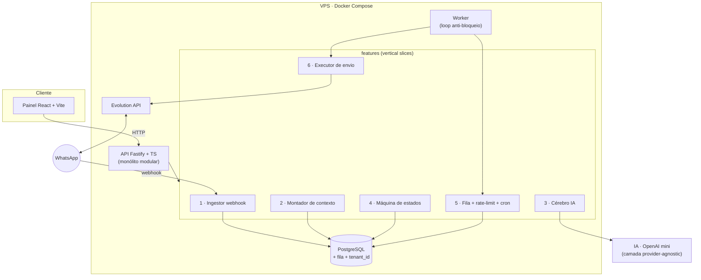
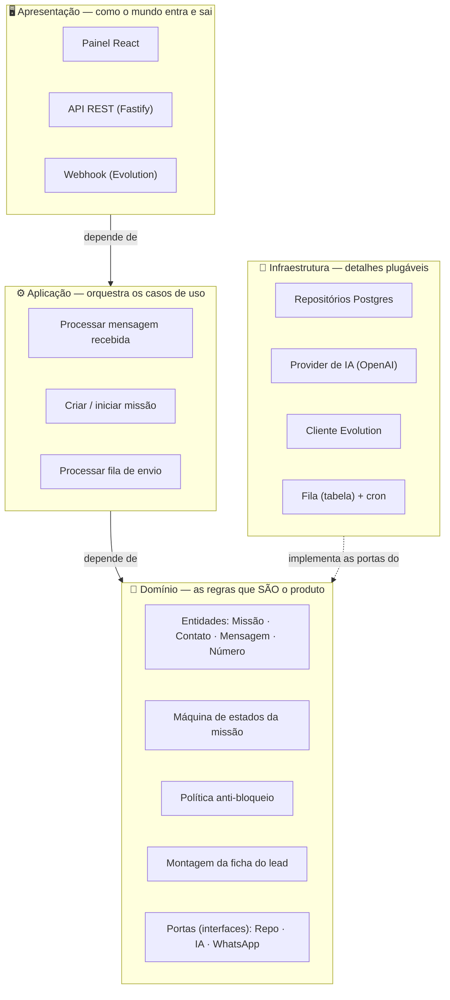
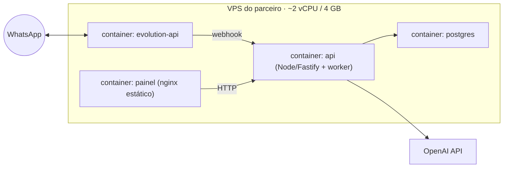

# zapagente — Arquitetura (decisões e alternativas)

> **O que estamos usando, por quê, e o que ficou de fora.** Consolida e explica as decisões dos estudos ([DECISÕES](estudos/DECISOES-stack-arquitetura-roadmap.md), [ARQUITETURA-TÉCNICA](estudos/ARQUITETURA-TECNICA.md)).
> Formato: para cada eixo → **a escolha**, **as alternativas**, **por que essa**.

**Legenda:** ✅ escolhido · ⛔ descartado (com motivo) · 🔮 futuro (revisitar depois).

---

## 0. Visão em uma imagem

Um **monólito modular** em Node: um processo com features bem separadas, um banco Postgres, a ponte de WhatsApp (Evolution) e o worker de envio. Tudo em containers na VPS.



---

## 1. Formato geral — **Monólito modular** ✅

Um único serviço Node, dividido internamente em *features* (vertical slices), com um *worker* rodando o loop anti-bloqueio no mesmo deploy.

| Opção | Prós | Contras | Veredito |
|---|---|---|---|
| **Monólito modular** ✅ | 1 deploy, 1 processo p/ debugar; transações simples no mesmo banco; rápido de evoluir; barato | Escala tudo junto (só importa em volume alto) | **Escolhido** — ideal p/ MVP e time de 1 dev |
| Microserviços | Escala por peça; isolamento | Complexidade de rede, deploy, observabilidade; over-engineering p/ o volume atual | ⛔ Só faz sentido com escala e time grande |
| Centrado em n8n | Visual, rápido de montar | Caixa-preta, acopla, difícil versionar/testar o ritmo fino | ⛔ Fora do core (ver §7) |
| Funções serverless | Zero infra, escala automática | **Não sustenta sessão/socket sempre ligado** (ver §3) | ⛔ Incompatível com WhatsApp não-oficial |

**Por quê:** o produto é sensível a **estado e ritmo** (conversas vivas, fila com atraso humano). Um monólito modular dá controle fino, transações fáceis e um único lugar pra pensar — sem o custo operacional de microserviços que a escala atual não justifica. A divisão em features já deixa a porta aberta pra extrair um serviço no futuro, se algum dia precisar.

---

## 1.1 · Modelo em camadas (multicamada) — por dentro do monólito

Se o **monólito modular** é a forma de fora, a arquitetura **em camadas** é como ele se organiza por dentro. A multicamada clássica separa **apresentação → negócio → dados** (3 camadas). A versão moderna (Clean / Hexagonal / Onion) refina em **4 camadas** com uma regra de ouro — a **Regra de Dependência**: tudo aponta **pra dentro**, em direção ao **Domínio**. É esse o nosso modelo.



**As 4 camadas do zapagente:**

- **🖥️ Apresentação** — entrada/saída do mundo: o painel React, as rotas HTTP da API e o webhook da Evolution. Valida payload e serializa. **Zero regra de negócio.**
- **⚙️ Aplicação** — os *casos de uso*: coordena o passo a passo (ex.: "mensagem recebida" = grava → monta ficha → chama IA → aplica estado → enfileira resposta). Orquestra, mas a regra em si mora abaixo.
- **💛 Domínio** — o **coração**, independente de tecnologia: entidades, a máquina de estados da missão, a política anti-bloqueio, a montagem da ficha e o contrato do structured output. **Não sabe que existe Postgres, OpenAI ou Evolution.**
- **🔌 Infraestrutura** — os detalhes plugáveis: repositórios Postgres, cliente Evolution, provider de IA, a fila (tabela) e o cron. **Implementa as portas** definidas pelo domínio.

**A Regra de Dependência (o pulo do gato):** o Domínio define **portas** (interfaces) — ex.: "existe um `RepositorioDeMissao`", "existe um `ProvedorDeIA`". A Infraestrutura **implementa** essas portas. Assim a dependência se **inverte**: em vez do domínio depender do Postgres, o Postgres é que se pluga no domínio. É *exatamente* por isso que "trocar de provider de IA = 1 arquivo": o domínio conversa com a **porta `IA`**, e a OpenAI é só uma implementação trocável. Bônus: dá pra testar o domínio inteiro sem banco nem WhatsApp (usa implementações falsas das portas).

**Os 7 blocos do backend mapeados nas camadas:**

| Bloco | Camada(s) |
|---|---|
| 1. Ingestor de webhook | Apresentação → Aplicação |
| 2. Montador de contexto | Domínio (regra) + Infra (lê repo) |
| 3. Cérebro IA | Aplicação (orquestra) + Infra (provider) + contrato no Domínio |
| 4. Máquina de estados | **Domínio (puro)** |
| 5. Fila + rate-limit + cron | Domínio (política) + Infra (tabela/worker) |
| 6. Executor de envio | Aplicação + Infra (cliente Evolution) |
| 7. API do painel | Apresentação |

**Camadas dentro de fatias:** no repo, a organização de topo é por **feature** (fatia vertical) e, dentro de cada uma, aparecem as **camadas** (horizontais). O que é compartilhado (portas + implementações de infra) vive em `/core`.

```
/apps/api/src
  /features
    /conversa
      conversa.rotas.ts       # 🖥️ Apresentação
      conversa.caso-uso.ts    # ⚙️ Aplicação
      conversa.dominio.ts     # 💛 Domínio (regras puras)
      conversa.repo.ts        # 🔌 Infraestrutura (Postgres)
    /missoes   ...
    /fila      ...
  /core                       # portas + infra compartilhada
    /db  /ia  /evolution  /fila
```

**Por que adotamos isso:** (1) trocar tecnologia (IA, WhatsApp, até o banco) sem tocar na regra; (2) testar o domínio isolado; (3) o código fica legível — cada arquivo tem *uma* responsabilidade de camada. O custo é um pouco mais de cerimônia (definir portas), que se paga rápido.

---

## 2. Camada de WhatsApp — **Evolution API (não-oficial)** ✅ · a decisão-mãe

Define risco de ban, custo e o que é permitido fazer.

| Opção | Como | Prós | Contras | Veredito |
|---|---|---|---|---|
| **Evolution API (Baileys)** ✅ | Sessão do WhatsApp Web logada no servidor | Grátis (só infra); **permite iniciar conversa** (prospecção); rápido | Viola ToS → **risco de ban**; Meta pode mudar protocolo | **Escolhido p/ MVP** — é o único que faz o caso de uso do parceiro |
| API Oficial (Cloud API Meta) | API empresarial | Sem ban; escala; entrega garantida | **€0,03–0,15/conversa**; exige verificação; **proíbe cold outreach** (só opt-in + templates) | 🔮 Fase 2 (inbound/opt-in, modo híbrido) |
| Baileys puro (lib) | Integrar a lib direto | Controle total | Reescrever o que a Evolution já entrega (multi-instância, webhook, API REST) | ⛔ Reinventar a roda |
| WPPConnect / Venom | Libs concorrentes | Alternativas ao Baileys | Mesmo risco, menos ecossistema/manutenção que a Evolution | ⛔ Sem ganho |
| BSP pago (Z-API, Twilio…) | Intermediário comercial | Facilidade | Custo recorrente + ainda preso às regras da Meta | ⛔ Custo sem resolver o cold outreach |

**Por quê:** o caso de uso central — a IA **começar** conversas (Modo A) — só é possível fora da API oficial. A Evolution entrega Baileys "pronto" (multi-instância, REST, webhook) e **também fala a API oficial**, então dá pra migrar pro **híbrido** na Fase 2 sem trocar de ferramenta. Risco de ban é aceito e mitigado pelo motor anti-bloqueio (§ ver ROADMAP/ARQUITETURA-TÉCNICA).

> ⚠️ **Risco de plataforma (2026):** o WhatsApp rastreia mensagens sem resposta em 48h, cumulativo e válido pra qualquer API. Por isso o produto favorece **base morna/opt-in**, não prospecção 100% fria.

---

## 3. Hospedagem — **VPS + Docker Compose** ✅

| Opção | Prós | Contras | Veredito |
|---|---|---|---|
| **VPS (Docker Compose)** ✅ | Processo **sempre ligado** (exigência da sessão); parceiro já tem; barato; 1 stack | Você cuida do SO/updates | **Escolhido** |
| Serverless (Cloudflare Workers) | Você domina; escala; zero infra | **Não mantém socket/sessão persistente** → incompatível com Evolution | ⛔ **Barreira técnica dura** |
| PaaS (Railway/Render/Fly) | Deploy fácil, always-on | Custo recorrente; menos controle | 🔮 Alternativa se não usar a VPS do parceiro |
| Kubernetes | Escala/orquestração | Over-engineering absurdo p/ 1 stack | ⛔ |

**Por quê:** a camada WhatsApp precisa de um **processo vivo com socket logado**. Isso elimina o serverless (mesmo o Cloudflare Workers que você manda bem) de cara. VPS com Docker Compose (postgres + evolution + api + painel) é o padrão leve, e o parceiro já tem servidor → custo de infra ~zero. Seu Cloudflare pode servir só o painel estático, se quiser.

---

## 4. Backend — **Fastify + TypeScript** ✅

| Opção | Prós | Contras | Veredito |
|---|---|---|---|
| **Fastify + TS** ✅ | Rápido; **validação por schema** nativa; leve; você domina Node | Menos "convenções" que o Nest | **Escolhido** |
| Express | Onipresente, simples | Sem schema nativo; mais boilerplate p/ validação | ⛔ Fastify faz melhor o mesmo |
| NestJS | Estrutura opinada, DI | Peso/curva desnecessários p/ MVP enxuto | ⛔ Over-structure agora |

**Por quê:** Fastify dá performance e **validação por schema** (importante porque o payload da IA e dos webhooks precisa ser validado), com pouco peso. Você já domina Node → risco baixo.

---

## 5. Banco de dados — **PostgreSQL** ✅

| Opção | Prós | Contras | Veredito |
|---|---|---|---|
| **PostgreSQL** ✅ | Relacional + `jsonb` (fatos/config flexível); `pgvector` p/ memória em grafo no futuro; robusto | — | **Escolhido** |
| MySQL | Hostinger costuma oferecer | Sem `pgvector`; jsonb mais fraco | ⛔ Postgres ganha em tudo que vamos precisar |
| SQLite | Zero setup | Concorrência fraca; não p/ processo sempre-ligado multi-write | ⛔ Só protótipo relâmpago |
| MongoDB | Flexível | Perdemos integridade relacional (missão↔contato↔mensagem é relacional) | ⛔ Modelo é naturalmente relacional |

**Por quê:** os dados são **relacionais** (contato 1—N missões, missão 1—N mensagens) mas com pontos flexíveis (`fatos`, `categorias`, config de missão) → `jsonb` resolve. E o Postgres guarda a carta na manga do **`pgvector`** pra memória em grafo/embeddings na Fase 3 — sem trocar de banco.

---

## 6. Fila + Agendador — **Fila no Postgres + worker** ✅

| Opção | Prós | Contras | Veredito |
|---|---|---|---|
| **Fila no Postgres + worker** ✅ | Sem infra extra; transacional com o resto; simples de inspecionar (é só uma tabela) | Não aguenta volume gigante | **Escolhido p/ MVP** |
| Redis + BullMQ | Alto throughput, retries/backoff prontos | +1 serviço na VPS; complexidade | 🔮 Quando o volume pedir |
| Fila gerenciada (SQS…) | Escala, durável | Custo + latência + acopla a nuvem | ⛔ Desnecessário |

**Por quê:** o motor anti-bloqueio **de propósito envia devagar** (ritmo humano: poucos por minuto). Não é cenário de alto throughput — é o oposto. Uma tabela `fila_envio` + um worker que lê a cada poucos segundos é simples, transacional e fácil de auditar. Redis entra só quando o volume real justificar.

---

## 7. Orquestração — **Node puro no core, n8n só na borda** ✅

| Opção | Prós | Contras | Veredito |
|---|---|---|---|
| **Node puro (core)** ✅ | Controle fino de ritmo/estado; testável; versionável | Você escreve tudo | **Escolhido p/ o crítico** |
| n8n no core | Visual, rápido de montar; parceiro gosta | Caixa-preta; difícil versionar/testar; ruim p/ ritmo fino | ⛔ Não no caminho crítico |
| n8n na borda | Integração fácil (puxar lead, notificar) | — | ✅ **Opcional, fora do core** |

**Por quê:** o coração (motor de missão, rate-limit, memória) precisa de **controle fino e testável** que o n8n não dá bem. Mas o n8n do parceiro é ótimo como **porta de integração** na borda (puxar lead de outro sistema, mandar notificação) — fica de fora do caminho crítico.

---

## 8. IA — **camada provider-agnostic, OpenAI mini como padrão** ✅

| Opção | Prós | Contras | Veredito |
|---|---|---|---|
| **Abstração provider-agnostic** ✅ | Trocar OpenAI↔Claude↔aberto = **1 arquivo**; sem lock-in | Um pouco mais de código na 1ª vez | **Escolhido** |
| Amarrar direto na OpenAI | Menos código agora | Lock-in; migração dolorosa depois | ⛔ Custa pouco evitar |
| Framework (LangChain etc.) | "Baterias inclusas" | Peso, abstração vazando, dependência pesada | ⛔ Não precisamos |

**Modelo:** **mini/econômico** em ~95% das conversas (ver [ESTUDO-memória-e-custo](estudos/ESTUDO-memoria-e-custo.md)); modelo frontier só em missão que exija raciocínio pesado. Contrato de saída = **structured output** (`resposta, novo_estado, categoria, fatos_novos, precisa_humano`).

**Por quê:** uma interface fina (`gerarResposta(contexto) → structured`) isola o provider. Começamos barato no mini e, se um cliente exigir outro modelo/provider, troca sem mexer no resto.

---

## 9. Multi-tenancy — **single-tenant, mas `tenant_id`-ready** ✅

| Opção | Prós | Contras | Veredito |
|---|---|---|---|
| **Row-level `tenant_id` desde já** ✅ | White-label depois **sem reescrever**; custa quase nada agora | Disciplina de sempre filtrar por tenant | **Escolhido** |
| Multi-tenant já no MVP | "Pronto pra vender" | Complexidade antes de validar | ⛔ Cedo demais |
| DB/schema por tenant | Isolamento forte | Operacionalmente pesado p/ muitos tenants pequenos | 🔮 Só se um cliente exigir isolamento |

**Por quê:** o MVP roda só pra Celiware (single-tenant), mas **toda tabela nasce com `tenant_id`**. Isso evita a reescrita dolorosa quando o white-label (Fase 3) chegar — é o meio-termo barato entre "não pensar nisso" e "construir o SaaS inteiro antes de validar".

---

## 10. Deploy (visão de implantação)



Envs principais: `DATABASE_URL`, `EVOLUTION_URL`, `EVOLUTION_API_KEY`, `OPENAI_API_KEY`, `TZ=America/Sao_Paulo`.

---

## 11. Resumo das decisões (ADR em uma tabela)

| Eixo | ✅ Escolha | Principais alternativas | Porquê (1 linha) |
|---|---|---|---|
| Formato | Monólito modular | Microserviços, n8n, serverless | Controle de estado/ritmo sem custo operacional de escala |
| WhatsApp | Evolution (Baileys) | API oficial, Baileys puro, BSP | Único que deixa a IA **iniciar** conversa |
| Hospedagem | VPS + Docker Compose | Serverless, PaaS, k8s | Sessão exige processo **sempre ligado** |
| Backend | Fastify + TS | Express, NestJS | Perf + validação por schema, leve |
| Banco | PostgreSQL | MySQL, SQLite, Mongo | Relacional + `jsonb` + `pgvector` futuro |
| Fila | Postgres + worker | Redis/BullMQ, SQS | Envio é lento de propósito; sem infra extra |
| Orquestração | Node no core | n8n no core | Ritmo fino testável; n8n só na borda |
| IA | Provider-agnostic + mini | Amarrar OpenAI, LangChain | Troca de provider = 1 arquivo; barato |
| Tenancy | `tenant_id`-ready | Multi já, DB-por-tenant | White-label depois sem reescrever |

---

## 12. Trade-offs assumidos — quando revisitar 🔮

- **Ban do chip:** risco aceito. Mitigação = motor anti-bloqueio + número aquecido. Se cair muito → migrar missões inbound pro **híbrido (API oficial + opt-in)**.
- **Fila no Postgres:** se o volume passar de ~centenas de envios/dia por instância → **Redis + BullMQ**.
- **Monólito:** se um bloco (ex.: IA) virar gargalo isolado → extrair só ele como serviço (as features já são fatias).
- **Modelo mini:** se a qualidade da conversa não segurar em missões complexas → subir de modelo naquela missão (a abstração permite por-missão).
