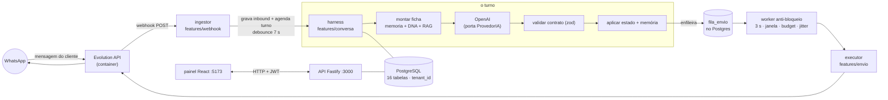
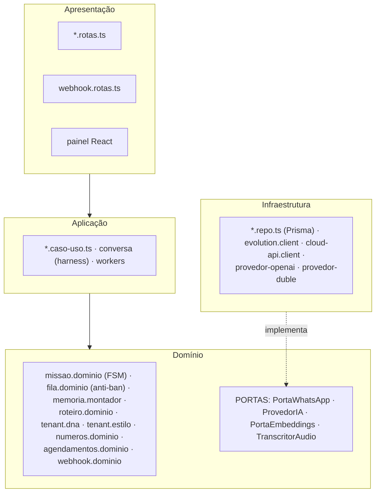

# Commagente — Arquitetura e funcionamento

> Reescrito em 09/09/2026 para uma pessoa entender o sistema **sozinha**, sem quem o construiu por
> perto. Vai da estrutura de pastas ao que acontece em cada mensagem recebida, em cada tick do
> worker e em cada comando. Onde o código tem uma decisão que não é óbvia, o motivo está no
> comentário do próprio arquivo; aqui fica o mapa que liga tudo.
>
> O que este documento **não** é: o plano ([ROADMAP.md](ROADMAP.md)), o passo a passo de máquina
> nova ([SETUP.md](SETUP.md)), o passo a passo da VPS ([DEPLOY.md](DEPLOY.md)) nem a pesquisa que
> fundamentou as escolhas ([estudos/](estudos/)). O diário de bordo do projeto — o que foi feito
> em cada dia, com o commit — vive em [`../CLAUDE.md`](../CLAUDE.md).
>
> **Mudança em relação à versão anterior:** este arquivo era só o registro de *decisões e
> alternativas*. Isso não se perdeu — virou a **§16**, atualizada. O resto do documento é novo e
> descreve o sistema **como ele está hoje**, não como foi planejado.

---

## 0 · Como ler

Se você tem dez minutos, leia 1, 2 e 14. Se vai mexer na conversa (IA, prompt, memória), leia 3 a
5. Se vai mexer em envio, chip ou anti-ban, leia 6. Se vai mexer no painel, 8. Se vai mexer no
banco, 9. Se vai subir para produção, 10 e 12. A 13 é o vocabulário interno; a 14 é o que está
pronto e o que não está; a 15 é o que quebra se você esquecer.

---

## 1 · O sistema em um parágrafo

O Commagente é um **assistente de IA que conduz conversas de WhatsApp em nome de uma empresa**,
várias em paralelo, cada uma com uma **missão** (vender, qualificar, orçar, cobrar, dar suporte).
É um **monólito modular** em Node/TypeScript: uma API [Fastify](https://fastify.dev) em
`apps/api`, um painel React/Vite em `apps/painel`, um **PostgreSQL** via Prisma, e a
**Evolution API** (Baileys, WhatsApp não-oficial) como ponte para o WhatsApp. Dentro do mesmo
processo da API rodam **três workers**: a **fila de envio** (a cada 3 s), o **agendador** de
missões programadas (a cada 5 min) e o **reconciliador** de status dos chips (a cada 5 min). Toda
mensagem que chega entra por um **webhook** e é processada pelo **harness**: a moldura
determinística em volta do LLM que monta o contexto, exige um contrato de saída em JSON, valida,
aplica o estado da missão, guarda a memória e **enfileira** a resposta — que só sai depois, no
ritmo humano, porque enviar rápido demais queima o chip. A plataforma é **multi-tenant** de
verdade (super-admin + tenants, isolamento por `tenant_id`, impersonação por `x-tenant-id`), roda
em produção numa VPS com Docker Compose + pm2 + Caddy, e está em uso por clientes reais.



Três coisas explicam quase todo o desenho:

1. **A conversa é assíncrona e lenta de propósito.** Nada é enviado na hora. Entre a IA decidir a
   resposta e o cliente recebê-la existe uma fila com atraso, janela de horário e budget diário.
2. **A IA nunca é a autoridade final.** Ela responde dentro de um contrato validado, e um
   guardrail escrito no prompt a proíbe de inventar preço, prazo ou promessa. Fora do que está
   autorizado, ela confirma ou escala para um humano.
3. **Tudo que é externo entra por uma porta.** WhatsApp, IA, transcrição e embeddings são
   interfaces (`core/*/porta-*.ts`) com pelo menos duas implementações — a real e um **dublê**
   offline. É o que permite rodar o sistema inteiro sem gastar token nem arriscar o chip.

---

## 2 · Mapa do repositório

```
commagente/
├── apps/
│   ├── api/                    a API Fastify + os três workers (o produto)
│   │   ├── src/
│   │   │   ├── server.ts       entrada: segurança HTTP, JWT, erros, /health, /ready,
│   │   │   │                   registra as features e sobe os workers no boot
│   │   │   ├── core/           o que é compartilhado por todas as features
│   │   │   │   ├── config.ts   todas as variáveis de ambiente + a TRAVA de produção
│   │   │   │   ├── db.ts       o PrismaClient (único ponto de acesso ao Postgres)
│   │   │   │   ├── auth.ts     payload do JWT + hook global que protege as rotas
│   │   │   │   ├── contexto.ts AsyncLocalStorage: quem é o tenant desta requisição
│   │   │   │   ├── erros.ts custo.ts senha.ts telefone.ts seed.ts tenant.ts
│   │   │   │   ├── evolution/  porta-whatsapp + adapter Evolution + adapter Cloud API
│   │   │   │   ├── ia/         porta-ia (o contrato de saída) + OpenAI + dublê
│   │   │   │   ├── embeddings/ porta + OpenAI + dublê (RAG do conhecimento)
│   │   │   │   ├── transcricao/porta + Whisper + dublê (nota de voz para texto)
│   │   │   │   └── documentos/ extração de texto de PDF/DOCX/TXT
│   │   │   └── features/       fatias verticais; dentro de cada uma, as camadas
│   │   │       ├── webhook/    o INGESTOR: recebe da Evolution e normaliza
│   │   │       ├── conversa/   o HARNESS: um turno de conversa ponta a ponta
│   │   │       ├── memoria/    o MONTADOR da ficha que vira prompt
│   │   │       ├── fila/       o motor anti-bloqueio (domínio + repo + worker)
│   │   │       ├── envio/      o EXECUTOR: fala com a Evolution, grava a saída
│   │   │       ├── missoes/    máquina de estados + CRUD + iniciar/escalar/rascunho
│   │   │       ├── campanhas/  a mesma missão para N contatos + relatórios
│   │   │       ├── agendamentos/ missões programadas + o agendador
│   │   │       ├── roteiro/    modo Roteiro: sequência guiada (domínio puro)
│   │   │       ├── contatos/ tags/ conhecimento/ midia/  a base e o que a IA sabe/envia
│   │   │       ├── tenant/     persona, estilo de conversa e DNA do cliente
│   │   │       ├── numeros/    chips: conectar (QR), saúde, reconciliador
│   │   │       ├── stats/      métricas do dashboard + o "vigia" de alertas
│   │   │       ├── inteligencia/ perguntar em linguagem natural sobre os dados da conta
│   │   │       └── auth/ admin/ login e tenants (super-admin)
│   │   ├── prisma/
│   │   │   ├── schema.prisma   A FONTE DA VERDADE do modelo de dados (16 models)
│   │   │   └── migrations/     42 migrações, de 21/07 a 24/08/2026
│   │   ├── scripts/            backfill-rag.mts (indexa o RAG) e rotate-admin.mts (senhas)
│   │   ├── .env.example        os nomes das variáveis (o .env real NUNCA é versionado)
│   │   └── dist/               FORA DO GIT — saída do tsc, hoje não usada (ver §15)
│   └── painel/                 o painel React + Vite + Tailwind v4
│       ├── src/App.tsx         o "roteador": um estado de rota, sem react-router
│       ├── src/lib/            api.ts (cliente HTTP), auth.ts (sessão), types.ts,
│       │                       tema.ts, toast.ts, ui.tsx, e os ESPELHOS do domínio
│       │                       da API (dna.ts, roteiro.ts, estilos-conversa.ts)
│       ├── src/pages/          uma página por aba da sidebar (15)
│       ├── src/components/     assistente de missão, editores de DNA/roteiro/estilo,
│       │                       seletores de contato/mídia, sidebar, modais
│       └── e2e/                Playwright do painel (desktop + mobile) + screenshots
├── e2e/                        Playwright de fluxo (login, navegação, missões, campanhas…)
├── infra/
│   ├── docker-compose.yml      db + evolution + evolution_db + evolution_redis
│   ├── docker-compose.demo.yml variação para demonstração
│   ├── Caddyfile               reverse proxy + HTTPS da VPS
│   └── init-db/01-evolution.sql
├── docs/                       este arquivo, SETUP, DEPLOY, ROADMAP, MODELO-DADOS,
│                               APRESENTACAO, escada-api-oficial, aprendizados-*, estudos/
├── recebidos/                  FORA DO GIT — material de reunião (PDFs, atas)
├── CLAUDE.md                   o diário de bordo: o que foi feito, quando e em qual commit
└── README.md                   a vitrine
```

---

## 3 · Camadas, portas e o harness

### 3.1 As quatro camadas

A organização de topo é por **feature** (fatia vertical); dentro de cada uma aparecem as
**camadas** (horizontais), marcadas com um emoji no cabeçalho de cada arquivo — é como você sabe,
em um segundo, o que aquele arquivo pode e não pode fazer:

| Emoji | Camada | O que é | Sufixo do arquivo |
|---|---|---|---|
| 🖥️ | Apresentação | Rotas HTTP e webhook. Valida payload e serializa. **Zero regra de negócio.** | `*.rotas.ts` |
| ⚙️ | Aplicação | Os casos de uso: coordena o passo a passo, orquestra. | `*.caso-uso.ts`, `*.worker.ts` |
| 💛 | Domínio | As regras que **são** o produto. Puras, sem I/O, testáveis sozinhas. | `*.dominio.ts` |
| 🔌 | Infraestrutura | Prisma, clientes HTTP, provedores. **Implementa as portas.** | `*.repo.ts`, `core/*/provedor-*.ts` |

A **Regra de Dependência**: tudo aponta para dentro, em direção ao Domínio. O domínio define
**portas** (interfaces); a infraestrutura as implementa. É por isso que "trocar de provider de IA
= um arquivo".



### 3.2 As quatro portas (e por que cada uma tem um dublê)

| Porta | Arquivo | Implementações | Seleção |
|---|---|---|---|
| WhatsApp | `core/evolution/porta-whatsapp.ts` | `evolution.client.ts` (Baileys) e `cloud-api.client.ts` (Meta oficial) | `WHATSAPP_PROVIDER` |
| IA | `core/ia/porta-ia.ts` | `provedor-openai.ts` e `provedor-duble.ts` | `IA_PROVIDER` |
| Embeddings | `core/embeddings/porta-embeddings.ts` | OpenAI e dublê | `EMBEDDINGS_PROVIDER` (segue `IA_PROVIDER`) |
| Transcrição | `core/transcricao/porta-transcricao.ts` | Whisper e dublê | `TRANSCRITOR_PROVIDER` (segue `IA_PROVIDER`) |

O **dublê** não é enfeite: com `IA_PROVIDER=duble` o sistema inteiro roda offline, determinístico,
sem key e sem custo. É como os testes E2E rodam e como se desenvolve sem queimar token. O dublê de
embeddings declara `semantico=false` — e a busca por relevância, sabendo disso, degrada sozinha
para "todo o conhecimento aprovado".

### 3.3 O harness

Um LLM sozinho é *stateless* e só prevê texto. Para virar assistente confiável ele precisa de uma
moldura **determinística** em volta: o **harness** (`features/conversa/conversa.caso-uso.ts`). Ele
faz seis coisas que o modelo cru não faz:

1. **Contexto** — decide o que entra no prompt (persona + DNA + memória + últimas 8 mensagens),
   não o histórico cru.
2. **Contrato** — exige JSON estruturado e valida com zod. Saída fora do contrato não passa.
3. **Estado** — aplica a transição na máquina de estados, e só se ela for válida.
4. **Memória** — persiste fatos na missão *e* no contato, e atualiza o resumo rolante.
5. **Guardrails** — `precisa_humano` pausa a IA e escala; campanha pausada trava tudo.
6. **Ritmo** — a resposta vai para a fila, nunca direto para o WhatsApp.

O termo "harness" também significa *scaffold de teste* — e aqui os dois sentidos se apoiam no
mesmo desenho: como IA e WhatsApp são portas, trocá-las por dublês dá conversas roteirizadas
offline de graça.

---

## 4 · O ciclo de vida de uma mensagem recebida

Este é o caminho completo, do celular do cliente até a resposta chegar de volta. Os números batem
com os comentários numerados em `conversa.caso-uso.ts`.

1. **A Evolution recebe do WhatsApp** e faz `POST` no nosso webhook. Em produção o segredo vai no
   caminho (`/webhook/<WEBHOOK_SECRET>`); caminho errado devolve **404** (não 401 — não revela que
   o endpoint existe).
2. **`webhook.rotas.ts` responde `{ok:true}` na hora** e processa em background (fire-and-forget
   com `.catch`). Segurar a resposta fazia a transcrição de áudio estourar o timeout da Evolution,
   o que virava reentrega em loop e custo dobrado.
3. **`webhook.dominio.ts` normaliza** o payload cru num `EventoWa` (regra pura, testada). Grupos
   `@g.us` são ignorados. Identificadores `@lid` (a privacidade nova do WhatsApp) são marcados.
4. **`webhook.caso-uso.ts` decide o que fazer**, nesta ordem:
   - acha o número pela `instanciaEvolution` (única no banco — é o que impede vazamento entre
     tenants);
   - **idempotência primeiro**: se já existe mensagem com aquele `providerMsgId` no tenant, sai;
   - **anti-poluição da base**: num número de campanha (suporte reativo desligado) um inbound de
     quem **não** é contato é descartado — senão o WhatsApp pessoal do operador enchia o CRM;
   - **correção do `@lid`**: mensagem de cliente pode chegar com `fromMe:true` errado. Se a
     conversa é gerida pela IA, trata como recebida — sem isso a conversa travava;
   - **suporte reativo**: inbound sem missão ativa num número marcado como reativo **abre uma
     missão de suporte na hora**;
   - **áudio**: nota de voz vira texto (Whisper) e segue o fluxo normal; se falhar, grava um
     marcador de "áudio recebido, não foi possível transcrever" e **não** aciona a IA;
   - grava a mensagem, registra o **opt-in implícito**, e se o texto for um pedido de parada
     (`ehPedidoOptOut`) marca **opt-out** e encerra;
   - por fim, **agenda o turno** (`agendarTurno`) — não dispara na hora.
5. **Debounce de 7 s.** Cada nova mensagem reinicia a janela. Rajada do cliente vira **um** turno.
6. **`processarTurno` pega um lock por missão.** Se já há turno rodando, **reagenda** em vez de
   descartar — a mensagem nova nunca fica sem resposta.
7. **Monta a ficha** (`memoria.montador`): persona do tenant + guia por tipo de missão + critério
   de conclusão + estilo de conversa + guardrail anti-invenção + regras de negócio do DNA +
   informações autorizadas + fatos + memória do contato + tags com descrição + DNA do contato +
   trechos relevantes do conhecimento (RAG) + mídias disponíveis + instrução do roteiro + as
   últimas 8 mensagens.
8. **Chama a IA e valida com `SaidaIASchema`.** Se a chamada falhar (401, 429, timeout), o erro
   **não some**: vira evento `erro_ia`, a missão escala, a IA pausa e o operador é avisado.
9. **Memória**: `fatos_novos` são mesclados na missão e no perfil do contato (persistem entre
   missões).
10. **Guardrails, em ordem de saída**: `precisa_humano` → escala, pausa a IA, envia a
    mensagem-ponte se houver, gera um resumo fresco para o handoff e para. Modo `copilot` → salva
    o **rascunho** e para (nada é enviado sem aprovação humana).
11. **Modo Roteiro** (se a campanha tem um): avança o ponteiro da sequência. Só no caminho
    automático — escalada e copilot já retornaram sem avançar, porque o passo não foi cumprido.
12. **Aplica o novo estado**, se a transição for válida na máquina de estados.
13. **Enfileira a resposta** em `fila_envio`, com tipo e jitter. Se enfileirar falhar, a missão
    **escala** — a resposta gerada nunca é perdida em silêncio.
14. **Mídia**: se a IA pediu para enviar um arquivo da biblioteca, entra um segundo item na fila,
    4 s depois. Uma trava determinística impede reenviar a mesma mídia na mesma missão.
15. **Aprendizado**: se a IA propôs uma lição geral, ela é gravada como `sugerido` — nunca entra
    na base sem curadoria humana.
16. **Resumo rolante** a cada 3 turnos (ou ao concluir), não a cada turno: as 8 mensagens cruas já
    cobrem a recência, e resumir sempre custava cerca de um terço a mais.

Depois disso a resposta **ainda não saiu**. Ela está na fila, e quem a tira de lá é a §6.

**A outra porta de entrada** é o **outbound frio**: `POST /missoes/:id/iniciar` (ou uma campanha,
ou o agendador no dia marcado) roda o mesmo harness sem inbound, gera o **opener** e enfileira com
tipo `novo` — que é o único tipo que passa pelo gate de janela e budget.

---

## 5 · O que a IA recebe e o que ela devolve

### 5.1 A hierarquia do que a IA "sabe"

Quatro camadas alimentam o prompt, e elas têm **prioridade declarada** — é o que impede uma
persona mal escrita de autorizar a IA a inventar preço:

```
REGRAS INVIOLÁVEIS (anti-invenção de preço, prazo e promessa)   <- vence tudo
   ^
REGRAS DE NEGÓCIO do DNA (definidas pelo cliente)
   ^
IDENTIDADE / persona do tenant (a voz da marca) + ESTILO (como escrever)
   ^
Objetivo, contexto e tom desta missão
```

O **DNA** é o conhecimento da empresa por categorias (`empresa`, `produtos`, `precos`,
`publicoAlvo`, `diferenciais`, `processoComercial`, `faq`, `glossario`, `casosSucesso`,
`regrasNegocio`) e é **hierárquico em três camadas**: tenant, campanha e missão, em ordem
crescente de prioridade, cada categoria podendo *Herdar*, *Substituir* ou *Combinar*. Dois
princípios governam o DNA: **defaults-first** (categoria vazia simplesmente não existe para o
prompt — nada de dez formulários em branco) e **orçamento de contexto** (cada categoria tem um
teto de caracteres, e o total também).

O **conhecimento** (memória coletiva) entra por RAG: cada item aprovado é fatiado
(`conhecimento.dominio.dividirEmChunks`) e vetorizado; o harness injeta só os trechos mais
próximos das últimas mensagens do lead. Se os embeddings estiverem indisponíveis ou não forem
semânticos, degrada para "todo o conhecimento aprovado" — `conhecimentoRelevante` **nunca lança**.

A **memória** tem dois níveis: `Missao.fatos` e `Missao.resumo` (esta conversa) e `Contato.memoria`
(o que sabemos da pessoa, atravessa missões).

### 5.2 O contrato de saída (`SaidaIASchema`, em `core/ia/porta-ia.ts`)

| Campo | O que é |
|---|---|
| `resposta` | o texto a enviar (obrigatório, não vazio) |
| `novo_estado` | um `EstadoMissao`; só é aplicado se a transição for válida |
| `categoria` | rótulo livre do turno (vai para o evento `turno_ia`) |
| `fatos_novos` | mapa chave/valor que vira memória da missão **e** do contato |
| `precisa_humano` e `motivo_escala` | o guardrail de escalada |
| `aprendizado_sugerido` | lição geral; vira `Conhecimento` com status `sugerido` |
| `enviar_midia` | id de um arquivo da biblioteca a mandar agora |
| `opcao_roteiro` | num passo de menu, o rótulo que o cliente escolheu |
| `resultado` | o desfecho — preencher só ao concluir |

A porta tem mais três métodos além de `gerar`: `resumir` (resumo rolante), `sintetizar`
(relatório narrativo de campanha) e `analisar` (a Central de Inteligência responde perguntas
**só** sobre um retrato pré-computado dos dados da conta — grounded, anti-invenção).

### 5.3 A máquina de estados (`features/missoes/missao.dominio.ts`)

```
configurada ──> na_fila ──> em_conversa ──> concluida ──> arquivada
     │             │            │   ^            │
     │             │            │   └─ escalada ─┤
     │             │            └──> sem_resposta ──> na_fila
     └─────────────┴───────────────> descartada ──> arquivada
```

`arquivada` é terminal. Três transições são **só do sistema** (`configurada` para `na_fila`,
`na_fila` para `em_conversa`, `sem_resposta` para `na_fila`): mudar o status na mão pulava o botão
*Iniciar* e a missão ficava muda para sempre. A rota manual usa `validarTransicao` (409 com
explicação); o fluxo interno usa `podeTransicionar` e segue livre.

---

## 6 · O motor anti-bloqueio (o que faz a resposta demorar de propósito)

Perder o chip é o risco existencial do produto. Por isso o envio passa por seis freios, todos em
`features/fila`:

| Freio | Onde | Regra |
|---|---|---|
| **Jitter** | `fila.dominio.jitterMs` | atraso aleatório antes de entrar em cena: `novo` 6–11 s, `conversa` 3–7 s |
| **Janela de horário** | `dentroDaJanela` | só 08:00–20:00 por padrão (por número, e suporta janela que cruza a meia-noite) |
| **Budget diário** | `temBudget` + `enviadosData` | contador por número, zerado na virada do dia no fuso do tenant |
| **Teto por estágio** | `tetoDiarioPorEstagio` | curva de aquecimento 20 / 50 / 120 / 250 / 400 — vale o **menor** entre ele e o budget |
| **Anti-rajada** | `intervaloEnvioMs` + `proximoEnvioEm` | intervalo mínimo entre dois envios do MESMO número: `novo` 45–90 s, `conversa` 12–30 s |
| **Saúde do número** | `numeros.dominio.classificarSaude` | taxa de resposta de 30 dias sobre openers com mais de 48 h; abaixo de 15% = **risco** e `iniciarMissao` devolve 409 |

**A distinção que mais importa:** janela e budget são freios de **outreach**, e só se aplicam ao
tipo `novo` — abrir conversa fria. Uma **resposta** a quem já falou com a gente (tipo `conversa`)
sempre flui, sujeita só a opt-out, anti-rajada e chip conectado. Foi exatamente isso que quebrou em
produção uma vez: o budget de outreach cortava a resposta a um cliente engajado, em silêncio. Hoje
`ehOpener` é "a missão não tem **nenhum** inbound", não "não tem saída anterior".

O **worker** (`fila.worker.ts`, tick de 3 s) é single-flight estrito — dois ticks simultâneos eram
a causa de mensagem duplicada. Além dos freios, cada tick:

- roda um **reaper** que recupera itens `enviando` órfãos com mais de 120 s (processo morreu no
  meio) — nunca um envio em curso, porque o corte usa `atualizadoEm`;
- respeita **pausa** de missão (humano assumiu) e de campanha;
- com o **chip offline**, não segura o item na frente da fila: **adia 5 min** (ou dá baixa depois
  de 24 h). Segurar entupia os 20 slots e matava de fome os outros chips do tenant;
- faz um **claim atômico** de `pendente` para `enviando`: quem não ganhar a transição pula. É a
  trava final contra duplicata;
- em falha, **retry com backoff** de 30 s a 10 min, 5 tentativas, depois dead-letter (`erro`).

O modo `semLimite` (por número) **bypassa todos os freios** — é o "sem freio" para teste, e quem
liga aceita o risco.

O **executor** (`envio/envio.caso-uso.ts`) faz o "digitando…" (presença) antes de mandar, e se o
estilo tiver **bolhas** ligado quebra a resposta em 2–3 mensagens curtas por quebra de linha. Cada
bolha conta no budget, mas continua sendo **um** item de fila (o anti-rajada é preservado). Se
algumas bolhas saíram e outras não, o erro **não** é propagado — reenviar duplicaria o que já
chegou.

---

## 7 · Os módulos da API

| Arquivo / pasta | Responsabilidade | O que **não** faz |
|---|---|---|
| `server.ts` | Helmet, CORS, rate-limit (300/min, isenta `/health` e `/ready`), JWT + hook global, handler de erro, `/health`, `/ready`, registra as 15 features e sobe os 3 workers | Não tem regra de negócio; 5xx não vaza internals |
| `core/config.ts` | Lê **todas** as envs num objeto só, mais a **trava de produção** que recusa subir com segredo fraco ou default | Nenhuma feature lê `process.env` por conta própria |
| `core/contexto.ts` | `tenantAtual()` e `conferirDono()` via AsyncLocalStorage | Worker e webhook não têm contexto: resolvem o tenant pelo recurso |
| `core/auth.ts` e `senha.ts` | JWT + bcryptjs; rotas públicas: `/health`, `/ready`, `/auth/login`, `/webhook` | — |
| `core/telefone.ts` | Normaliza para o formato com DDI 55 | Sem o 55 o JID é inválido e a Evolution diz que o número não existe |
| `core/custo.ts` | Preço do modelo num lugar só (entrada, saída, câmbio) e o teto de alerta | O painel usa os mesmos números |
| `webhook/*` | Ingestor: normaliza (domínio puro), decide, grava, agenda o turno | Não chama a IA direto — sempre pelo debounce |
| `conversa/*` | O harness (§4) mais aprovar e descartar rascunho | Não envia nada: enfileira |
| `memoria/memoria.montador.ts` | Monta a ficha; compõe a persona com o guardrail | Não lê banco: recebe a missão já carregada |
| `fila/*` | Domínio anti-ban puro, repo (`fila_envio` e contadores) e worker | O domínio não sabe que existe Postgres |
| `envio/*` | Executor: presença, bolhas, documento, grava em `mensagens` | `/envio` (manual) confere dono; o worker chama direto |
| `missoes/*` | FSM, criar (unitário e em lote), iniciar, escalar/assumir/devolver, rascunho, `/escalados` | Não decide o texto: isso é do harness |
| `campanhas/*` | Definição compartilhada por N missões; adicionar contatos depois; pausar; duplicar; relatório (JSON, CSV e síntese por IA) | Não tem fila própria: usa a das missões |
| `agendamentos/*` | Missões programadas; recorrências (uma vez, diário, dias úteis, semanal, a cada X, mensal, anual); idempotência por ciclo | Não envia: cria a missão e enfileira |
| `roteiro/roteiro.dominio.ts` | Sequência guiada: passos, menu de um nível, avanço do ponteiro | Não fala com a IA; a IA só cuida da língua |
| `conhecimento/*` | Curadoria (sugerido, aprovado, rejeitado), ingestão de documento e de URL (com anti-SSRF), chunking e indexação RAG | Indexação é best-effort: nunca derruba a criação |
| `midia/*` | Biblioteca de arquivos que a IA pode enviar; tipo de envio escolhido pelo mimetype | — |
| `contatos/*` e `tags/*` | O CRM: criar, importar (CSV e agenda do WhatsApp), exportar, DNA do contato, tags que viram conhecimento | — |
| `tenant/*` | Persona (voz), estilo de conversa (regras de escrita) e DNA do tenant | Escopo é o tenant efetivo da requisição |
| `numeros/*` | Conectar por QR, status, apelido, suporte reativo, aviso de escalonamento, saúde e o **reconciliador** (5 min) | O reconciliador não altera status se a Evolution estiver fora |
| `stats/*` | Dashboard: KPIs, placar, histórico por dia, e o **vigia** (chip em risco, número parado), com cache de TTL curto | Sem canal externo: o alerta aparece no painel |
| `inteligencia/*` | Pergunta em linguagem natural sobre um retrato agregado da conta | Não é RAG sobre tudo: é agregado pré-computado mais guardrail |
| `admin/*` | Super-admin: listar e criar tenants, custo por tenant, monitoramento ao vivo | Custo só o super-admin vê |

### 7.1 A API HTTP em uma tabela

Tudo exige `Authorization: Bearer <jwt>`, exceto `/health`, `/ready`, `/auth/login` e `/webhook`.
O super-admin escolhe o tenant com o header `x-tenant-id`.

| Grupo | Rotas |
|---|---|
| saúde | `GET /health` · `GET /ready` |
| auth | `POST /auth/login` · `GET /auth/eu` · `POST /auth/aceitar-termos` |
| admin | `GET /admin/tenants` · `POST /admin/tenants` |
| números | `GET /numeros` · `POST /numeros` · `PATCH /numeros/:id` · `DELETE /numeros/:id` · `POST /numeros/:id/conectar` (QR) · `/desconectar` · `/testar-aviso` · `GET /numeros/:id/status` |
| webhook | `GET` e `POST` em `/webhook` e `/webhook/:segredo` |
| missões | `GET` e `POST /missoes` · `GET` e `PATCH /missoes/:id` · `POST /missoes/lote` · `/missoes/iniciar-lote` · `/missoes/:id/iniciar` · `/:id/estado` · `/:id/assumir` · `/:id/devolver-ia` · `/:id/rascunho/aprovar` e `/descartar` · `GET /escalados` |
| campanhas | `GET` e `POST /campanhas` · `GET`, `PATCH` e `DELETE /campanhas/:id` · `POST /:id/contatos` · `/:id/iniciar` · `/:id/pausar` · `/:id/duplicar` · `GET /:id/relatorio` e `/relatorio/csv` · `POST /:id/relatorio/sintetizar` |
| programadas | `GET` e `POST /agendamentos` · `POST /agendamentos/lote` · `PATCH` e `DELETE /agendamentos/:id` · `POST /:id/pular` · `/:id/disparar` |
| contatos e tags | `GET` e `POST /contatos` · `GET` e `PATCH /contatos/:id` · `POST /contatos/importar` · `/importar-whatsapp` · `GET /contatos/exportar` · `GET` e `POST /tags` · `PATCH` e `DELETE /tags/:id` · `POST /tags/:id/contatos` · `POST /contatos/:id/tags` · `DELETE /contatos/:id/tags/:tagId` |
| conhecimento e mídia | `GET` e `POST /conhecimento` · `PATCH` e `DELETE /conhecimento/:id` · `POST /conhecimento/:id/status` · `POST /conhecimento/importar-url` · `GET` e `POST /midia` · `DELETE /midia/:id` |
| tenant | `GET` e `PATCH /tenant` (persona + estilo + DNA) |
| métricas | `GET /stats` · `GET /stats/historico?dias=N` · `POST /inteligencia/perguntar` |
| envio manual | `POST /envio` |

---

## 8 · O painel

React 19 + Vite + Tailwind v4, **sem react-router**: `App.tsx` guarda um estado de rota e
renderiza a página. É pequeno e funciona; o custo é não ter URL por página (a aba aberta não é
linkável e o botão voltar do navegador não navega no app).

- `lib/api.ts` — o cliente HTTP: prefixo `/api` (o Vite faz proxy para a porta 3000, então **não
  há CORS em dev**), injeta o token e o `x-tenant-id`, e um 401 dispara o logout global.
- `lib/auth.ts` — sessão no `localStorage` (token, usuário, tenant selecionado).
- `lib/tema.ts` — claro/escuro por `data-theme`, aplicado **antes** do React montar (evita flash).
- **Espelhos**: `lib/dna.ts`, `lib/roteiro.ts`, `lib/estilos-conversa.ts` e `lib/types.ts`
  duplicam de propósito tipos e listas que vivem no domínio da API. Não há pacote compartilhado —
  **mexeu de um lado, mexa do outro** (está escrito no cabeçalho de cada um).
- **Páginas** (uma por aba): Dashboard, Inteligência, Missões, Detalhe da missão, Campanhas,
  Programadas, Escalados, Contatos, Tags, DNA, Voz & estilo, Biblioteca, Números, Tenants, Login.
- **Componentes de peso**: `AssistenteMissao` (o builder em 3 passos: modelo, ajustar, contatos),
  `EditorRoteiro` (a sequência guiada), `EditorDnaCamada` (Herdar/Substituir/Combinar),
  `EstiloControles` (com preview vivo), `SeletorContatos`, `SeletorMidia`, `TermosModal`.

---

## 9 · Dados

O schema Prisma (`apps/api/prisma/schema.prisma`) é a **fonte da verdade** e está bem comentado —
leia-o quando a dúvida for de campo. O ERD visual e as convenções de nomenclatura estão em
[MODELO-DADOS.md](MODELO-DADOS.md). Aqui fica o que aquele arquivo não diz: **quem escreve e quem
lê cada tabela.**

São **16 models** (o README antigo dizia 8, depois 11 — os dois números morreram):

| Tabela | O que guarda | Quem escreve | Quem lê |
|---|---|---|---|
| `tenants` | O cliente da plataforma, mais `persona` (voz), `estilo` (como escrever) e `dna` (conhecimento por categoria) | seed, `POST /admin/tenants`, `PATCH /tenant` | tudo (raiz do isolamento), montador de ficha |
| `usuarios` | Login do painel; `tenantId` nulo é super-admin; `aceitouTermosEm` (LGPD) | seed, criar tenant, aceitar termos | auth |
| `numeros_whatsapp` | O chip: instância Evolution (**única**), status, aquecimento, budget, janela, suporte reativo, aviso de escalonamento, `semLimite` | painel, worker (contadores), reconciliador, webhook (status) | worker, harness, vigia, ingestor |
| `contatos` | O lead: telefone (único no tenant), `memoria` individual, `dna`, opt-in e opt-out | painel, importação, ingestor (só quando permitido), harness | tudo que conversa |
| `tags` e `contato_tags` | Segmentação; a **descrição da tag é conhecimento** injetado no prompt | painel | montador de ficha, seleção de audiência |
| `missao_templates` | Missão reutilizável (objetivo, persona, tom, categorias) | painel | missões |
| `missoes` | A instância viva: contato + número + estado + memória + modo + estilo + DNA + `roteiroEstado` + tokens | harness, casos de uso, agendador | painel, stats, fila, relatórios |
| `campanhas` | A definição compartilhada por N missões, mais `roteiro` e `pausada` | painel | missões (herança ao vivo), relatórios |
| `agendamentos` | Missão programada por contato: recorrência, entrega (`ia` ou `fixa`), idempotência por ciclo | painel | agendador (5 min) |
| `mensagens` | O histórico; `@@unique([tenantId, providerMsgId])` é a idempotência | ingestor, executor | painel, montador de ficha, stats |
| `fila_envio` | O que está para sair, com `agendadoPara`, `tentativas` e `atualizadoEm` (o carimbo do claim) | harness, agendador, aprovação de rascunho | worker |
| `eventos` | Trilha de auditoria: `turno_ia`, `escalada`, `erro_ia`, `opt_out`, `suporte_reativo`, `audio_transcrito`, `midia_enviada`, `chip_desconectado`, `aviso_escalonamento`, `rascunho` | quase todo mundo | painel (timeline), diagnóstico |
| `conhecimento` | Memória coletiva curada; `sugerido`, `aprovado` ou `rejeitado`; categoria do DNA | painel, harness (sugestões da IA) | RAG |
| `conhecimento_chunks` | Os trechos vetorizados (cosseno **em memória**, sem pgvector) | indexação e `backfill-rag.mts` | RAG |
| `midia` | Os arquivos que a IA pode enviar, em `bytea` | painel | harness, executor |

Notas que economizam uma hora de investigação:

- **Toda tabela tem `tenant_id`** e o isolamento é por linha. `conferirDono()` devolve **404** (não
  403) em recurso de outro tenant, para não revelar que ele existe.
- **`providerMsgId` vazio vira `NULL`.** Como string vazia a constraint única colidia e a segunda
  mensagem sem id sumia.
- **Mídia mora no banco** (`Bytes`), não em disco nem em bucket. Simples, e funciona até a base
  crescer.
- **Migrações**: 42, de `20260721022316_init` a `20260824180000_modo_roteiro`. Em banco com dado,
  use `prisma migrate deploy` — `migrate dev` é interativo e trava em ambiente headless.

---

## 10 · Configuração, ambientes e deploy

### 10.1 Variáveis (só os **nomes**; valores nunca entram em documento nem em comentário)

| Variável | Para quê |
|---|---|
| `DATABASE_URL` | Postgres da aplicação |
| `PORT` e `TZ` | porta (3000) e fuso (`America/Sao_Paulo` — o budget e a janela dependem dele) |
| `EVOLUTION_URL` e `EVOLUTION_API_KEY` | a ponte WhatsApp não-oficial |
| `WHATSAPP_PROVIDER` | `evolution` (padrão) ou `cloud` |
| `CLOUD_API_TOKEN`, `CLOUD_API_PHONE_ID`, `CLOUD_API_VERIFY_TOKEN`, `CLOUD_API_GRAPH_VERSION` | a Cloud API oficial da Meta (degrau 1) |
| `IA_PROVIDER`, `OPENAI_API_KEY`, `OPENAI_MODEL` | a IA (`duble` roda tudo offline) |
| `TRANSCRITOR_PROVIDER`, `TRANSCRITOR_MODELO`, `TRANSCRITOR_IDIOMA` | nota de voz para texto |
| `EMBEDDINGS_PROVIDER` e `EMBEDDINGS_MODEL` | o RAG do conhecimento |
| `WEBHOOK_URL` e `WEBHOOK_SECRET` | onde a Evolution entrega e o segredo no caminho |
| `JWT_SECRET`, `SUPER_ADMIN_EMAIL`, `SUPER_ADMIN_SENHA` | autenticação e o seed do super-admin |
| `CORS_ORIGIN` | origem(ns) do painel em produção |
| `NODE_ENV` | `production` **liga a trava** do `config.ts` |

**A trava de produção** (fim de `core/config.ts`): com `NODE_ENV=production`, a API **recusa
subir** se `JWT_SECRET`, `SUPER_ADMIN_SENHA`, `WEBHOOK_SECRET`, `EVOLUTION_API_KEY` ou
`CORS_ORIGIN` estiverem ausentes, curtos ou iguais a um default conhecido. Foi criada porque o
super-admin de produção já rodou com a senha default.

### 10.2 Os ambientes

| | Local | Produção (VPS) |
|---|---|---|
| Subir | `docker compose -f infra/docker-compose.yml up -d`, depois `cd apps/api && npm run dev` e `cd apps/painel && npm run dev` | pm2 + Caddy (ver [DEPLOY.md](DEPLOY.md)) |
| API | `http://localhost:3000` | atrás do Caddy, em `/api/*` |
| Painel | `http://localhost:5173` (proxy `/api` para a 3000) | build estático servido pelo Caddy |
| Evolution | `127.0.0.1:8080` | `127.0.0.1:8080` — **nunca** exposta |
| Postgres | `127.0.0.1:5432` | idem, mais `pg_dump` em cron às 03:00 com rotação de 14 dias |
| IA | `IA_PROVIDER=duble` (sem custo) | `openai` |
| Processo | `tsx watch src/server.ts` | `node dist/server.js` (depois de `npm run build`) sob pm2 (`commagente-api`) |

Até 01/11/2026 a produção rodava `npx tsx src/server.ts`, porque os imports ESM não tinham
extensão `.js` e o build compilado quebrava. Desde o branch `revisao-2026-11`, todo import relativo
termina em `.js`, o `tsconfig` usa `NodeNext` (o compilador recusa import sem extensão) e o caminho
é `npm run build` + `node dist/server.js`. Os testes continuam rodando direto no TS (`npm test`).

Herança de nome: o produto se chama Commagente desde 28/07/2026, mas a infra viva ainda usa
`zapagente` (containers `zapagente-*`, banco, logins no domínio `zapagente.local`, pasta
`~/zapagente`, instância `zap-<telefone>`). Renomear é uma janela de manutenção à parte.

---

## 11 · Como conferir

| O quê | Comando | Estado em 09/09/2026 |
|---|---|---|
| Testes de unidade (domínio puro) | de `apps/api/`: `npx tsx --test src/**/*.test.ts` | **61/61 passando**, 8 arquivos, menos de 1 s |
| Tipos da API | de `apps/api/`: `npx tsc -p tsconfig.json --noEmit` | — |
| Tipos e build do painel | de `apps/painel/`: `npm run build` | — |
| Lint do painel | de `apps/painel/`: `npm run lint` (oxlint) | — |
| E2E de fluxo | de `e2e/`: `npm test` (Playwright) | exige banco, API e painel de pé |
| E2E do painel (desktop e mobile) | de `apps/painel/`: `npm run test:e2e` | idem |
| API viva | `curl localhost:3000/health` e `/ready` | — |

Os oito arquivos de teste cobrem o que **é** o produto e não depende de I/O: máquina de estados,
recorrência de agendamento, normalização do webhook (incluindo `@lid`), montagem da ficha, DNA do
tenant e do contato, roteiro e o parser de contatos da Evolution.

Não há script `test` no `package.json` da API — os testes rodam pelo `--test` do Node via `tsx`.

Os dois conjuntos E2E se sobrepõem em parte (ambos têm um `tema.spec.ts`) e rodam contra o banco
de **desenvolvimento**, em série. Eles fazem login com credenciais de seed escritas no código de
teste; isso vale para dev e **não** deve ser replicado em produção.

---

## 12 · Receitas

**Ligar um chip novo:** painel, Números, *Novo* (telefone + apelido), *Conectar*, escaneie o QR no
WhatsApp do celular. O status vira `conectado` (o reconciliador confere de novo a cada 5 min). Chip
novo nasce no estágio 1 de aquecimento (teto de 20 por dia) — não force.

**Disparar uma campanha:** painel, Campanhas, *Nova*, escolha um **modelo** (ele preenche objetivo,
tom, critério, modo e o perfil de conversa), ajuste, escolha os contatos, *Iniciar*. Cada contato
vira uma missão; os openers saem gotejando pela fila.

**Deixar um número atendendo o dia inteiro:** Números, ligue **suporte reativo** e preencha
objetivo, tom e informações. Qualquer inbound sem missão ativa abre uma conversa de suporte na
hora.

**Missão que dispara sozinha todo mês** (cobrança, por exemplo): Programadas, *Novo agendamento*,
recorrência `mensal` mais o dia do mês, entrega `ia` (a IA conduz) ou `fixa` (só manda o texto).
Dia 31 em mês curto cai no último dia; "já pagou este mês" é o botão *pular ciclo*.

**Ensinar algo à IA:** DNA (por categoria) para o que a empresa **é**; Biblioteca para arquivos que
ela pode **enviar**; Conhecimento para documentos e links (`POST /conhecimento/importar-url` tem
anti-SSRF). Depois de subir muita coisa de uma vez, ou ao trocar de provider de embeddings:
`cd apps/api && npx tsx scripts/backfill-rag.mts`.

**Assumir uma conversa:** Escalados, abrir, *Assumir* (a IA fica pausada e você digita), *Devolver
para a IA* quando terminar. Em modo **copilot** a IA escreve mas não envia: você aprova, edita ou
descarta o rascunho.

**Chip caído:** o painel mostra o alerta (vigia) e o evento `chip_desconectado` é gravado. Os itens
da fila são **adiados**, não perdidos — quando o chip volta, saem. Se a instância travou de vez, o
procedimento é `POST /settings/set/{inst}` e `DELETE /instance/logout/{inst}` na Evolution, depois
re-parear com sessão limpa.

**Rotacionar a senha do super-admin:** de `apps/api/`, defina `NEW_ADMIN_PW` no ambiente e rode
`npx tsx scripts/rotate-admin.mts`.

**Banco existente, código novo:** `npx prisma migrate deploy` (nunca `migrate dev` em produção;
para constraint nova, confira duplicatas antes).

**Rodar tudo sem gastar token:** `IA_PROVIDER=duble` no `.env` — IA, transcrição e embeddings caem
todos no dublê.

---

## 13 · Vocabulário interno

| Termo | Significa |
|---|---|
| **Missão** | Uma conversa com um objetivo, com um contato, por um número. É a unidade do produto |
| **Campanha** | A mesma definição de missão disparada para N contatos; herda ao vivo DNA, mídia, estilo e roteiro |
| **Harness** | A moldura determinística em volta do LLM (`conversa.caso-uso.ts`) |
| **Turno** | Uma volta do harness: entrada, IA, estado, resposta enfileirada |
| **Ficha** | O contexto montado que vira prompt (`memoria.montador`) |
| **DNA** | O conhecimento da empresa por categorias, hierárquico: tenant, campanha, missão |
| **Persona / voz** | A identidade do tenant no prompt. Governa o **tom**, nunca os fatos |
| **Estilo de conversa** | Controles de COMO escrever: formalidade, emoji, abreviação, travessão proibido, bolhas |
| **Bolhas** | Quebrar a resposta em 2–3 mensagens curtas — um item de fila, várias mensagens |
| **Informações autorizadas** | A única base de fatos que a IA pode afirmar (preço, prazo, condição) |
| **Guardrail** | A regra inviolável anti-invenção; fora dela a IA confirma ou escala |
| **Escalar** | Entregar a conversa a um humano: pausa a IA, grava o motivo, cai no inbox de Escalados |
| **Copilot** | Modo em que a IA rascunha e o humano aprova antes de enviar |
| **Opener** | A primeira mensagem de uma conversa **fria** (tipo `novo` na fila) |
| **Suporte reativo** | Número que abre missão sozinho quando alguém escreve |
| **Roteiro** | Sequência guiada de perguntas e menus que a campanha impõe à conversa |
| **Aquecimento / estágio** | A maturidade do chip (1 a 5), que define o teto diário |
| **Vigia** | Os alertas calculados na leitura do dashboard (chip em risco, número parado) |
| **Dublê** | Implementação offline e determinística de uma porta (IA, áudio, embeddings) |
| **Tenant** | O cliente da plataforma. O super-admin opera "como" um tenant via `x-tenant-id` |

---

## 14 · Status em 09/09/2026 (medido no código, não no plano)

| Área | Estado | Onde conferir |
|---|---|---|
| API, harness, fila, ingestor, executor | **Pronto e em produção.** 61/61 testes de unidade | `apps/api/src`, §11 |
| Multi-tenant, auth, isolamento, impersonação | **Pronto.** `tenant_id` em toda tabela, IDOR fechado com 404 | `core/contexto.ts` |
| Anti-bloqueio | **Pronto**: janela, budget, teto por estágio, anti-rajada, saúde, opt-out | `features/fila`, `features/numeros` |
| Missões com tipo, critério e resultado | **Pronto** | `memoria.montador` (GUIA_TIPO) |
| Memória individual e coletiva, com RAG | **Pronto**, com cosseno **em memória** (sem pgvector) | `core/embeddings`, `conhecimento_chunks` |
| Áudio, builder visual, escada para a API oficial | **Pronto no código.** O adapter Cloud API existe e compila, mas o degrau 1 **nunca rodou em produção** | `core/evolution/cloud-api.client.ts` |
| CRM, campanhas, programadas, tags, DNA, biblioteca, roteiro | **Pronto** | §7 |
| Painel | **Pronto** e responsivo (desktop e mobile), tema claro e escuro | `apps/painel` |
| Deploy always-on | **No ar**: pm2, Caddy, backup do Postgres em cron, logrotate, trava de produção | [DEPLOY.md](DEPLOY.md) |
| Camada comercial (planos, quotas, billing, teto de custo por tenant, hard-delete LGPD) | **Não existe.** Há custo por missão e alerta de custo por tenant, nada mais | ROADMAP §8.5 |
| Cap horário de envio, progressão automática de estágio, pool de chips, proxy por chip | **Não feito** (radar do anti-ban) | ROADMAP |
| Race do suporte reativo (dois inbounds simultâneos podem criar duas missões) | **Conhecido, não corrigido** — falta constraint ou transação | `webhook.caso-uso.ts` |
| `SELECT FOR UPDATE SKIP LOCKED` na fila | **Não feito** — só faria falta com um segundo worker; hoje é um processo só | `fila.repo.ts` |
| Testes E2E | Dois conjuntos (`e2e/` e `apps/painel/e2e/`) com sobreposição; ambos exigem a stack local de pé | §11 |
| Documentação | Este arquivo, SETUP, DEPLOY, ROADMAP, MODELO-DADOS e escada-api-oficial valem. `docs/estudos/` é histórico de fundamentação | `docs/` |
| Comentários no código | Todo arquivo de `apps/api/src`, `apps/painel/src`, `scripts/` e dos dois E2E abre com um cabeçalho dizendo o que é e por quê; as decisões não óbvias estão comentadas no lugar | — |

---

## 15 · Armadilhas conhecidas

- **`node dist` não sobe.** Os imports ESM não têm `.js`; produção roda `npx tsx src/server.ts`.
- **`prisma migrate dev` trava em ambiente headless** (é interativo). Em banco com dado, sempre
  `migrate deploy` — e confira duplicatas antes de criar constraint única.
- **ufw bloqueia o webhook.** A Evolution entrega no host via `host.docker.internal:3000`; com
  default-deny esse tráfego é **dropado sem erro visível** e as mensagens simplesmente não
  aparecem. Libere as bridges internas do Docker para a porta 3000. Para diagnosticar de dentro do
  container, use o `fetch` do Node contra `/health` — o container não tem `curl`.
- **"Aguardando esta mensagem" não é bug nosso.** Quando a sessão Baileys não decifra, a Evolution
  não emite `messages.upsert` e o inbound nunca chega. Mitigações já aplicadas: `groupsIgnore`,
  `rejectCall`, `syncFullHistory:false`, celular pareado e online. **Cura definitiva é a Cloud API
  oficial.**
- **`@lid`**: mensagem de cliente pode vir com `fromMe:true`. Sem a reinterpretação do
  `webhook.caso-uso.ts`, a conversa trava sem erro nenhum.
- **Budget de outreach nunca pode cortar resposta.** Janela e budget valem só para o tipo `novo`.
  Se alguém mexer nisso, o sintoma é o pior possível: cliente engajado sem resposta, em silêncio.
- **Cada bolha conta no budget.** Estilo com bolhas gasta o teto diário três vezes mais rápido.
- **`enterWith` do AsyncLocalStorage não propaga** — use `als.run(store, done)` (callback-style),
  como está em `core/contexto.ts`.
- **Telefone sem DDI 55 é JID inválido** e a Evolution responde que o número não existe. Sempre
  `telefoneBR()`.
- **Fuso**: janela, budget diário e recorrência dependem de `TZ`. Errar isso desalinha o produto
  inteiro em algumas horas.
- **Promessa solta.** Todo `setInterval` de worker precisa de `.catch` — sem ele um erro
  transitório de banco vira unhandled rejection e derruba o processo.
- **Os espelhos do painel** (`lib/dna.ts`, `lib/roteiro.ts`, `lib/estilos-conversa.ts`,
  `lib/types.ts`) não são gerados: mexeu no domínio da API, mexa neles.
- **Cosseno em memória** carrega todos os chunks do tenant a cada consulta. Funciona hoje; com base
  grande, é pgvector.
- **Não exponha a Evolution.** A porta 8080 é acesso direto ao WhatsApp do cliente — só rede
  interna.

---

## 16 · Decisões de stack e alternativas

Esta era a totalidade da versão anterior deste documento. Continua valendo, com uma correção
importante ao fim (§16.9).

**Legenda:** ✅ escolhido · ⛔ descartado · 🔮 futuro.

### 16.1 Formato — **monólito modular** ✅

| Opção | Prós | Contras | Veredito |
|---|---|---|---|
| **Monólito modular** ✅ | 1 deploy, 1 processo para depurar; transações no mesmo banco; barato | Escala tudo junto | **Escolhido** — o produto é sensível a estado e ritmo |
| Microserviços | Escala por peça | Complexidade de rede, deploy e observabilidade | ⛔ Over-engineering para o volume |
| Centrado em n8n | Visual, rápido de montar | Caixa-preta; difícil versionar e testar ritmo fino | ⛔ Fora do core |
| Serverless | Zero infra | **Não sustenta socket/sessão sempre ligada** | ⛔ Incompatível com o WhatsApp não-oficial |

### 16.2 WhatsApp — **Evolution API (Baileys)** ✅ · a decisão-mãe

| Opção | Prós | Contras | Veredito |
|---|---|---|---|
| **Evolution (Baileys)** ✅ | Grátis; **permite iniciar conversa**; multi-instância, REST e webhook prontos | Viola os termos, então há risco de ban; a Meta muda o protocolo | **Escolhido** — é o único que faz o caso de uso |
| Cloud API oficial (Meta) | Sem ban; entrega garantida | Custo por conversa; **proíbe cold outreach**; janela de 24 h e templates | 🔮 Degrau 1, adapter **já escrito** |
| Baileys puro | Controle total | Reescrever o que a Evolution entrega | ⛔ |
| WPPConnect / Venom | Alternativas | Mesmo risco, menos ecossistema | ⛔ |
| BSP pago | Facilidade | Custo e ainda preso às regras da Meta | ⛔ |

> ⚠️ O WhatsApp rastreia mensagens sem resposta em 48 h, cumulativo, e isso vale para qualquer API.
> Por isso o produto favorece base morna ou opt-in, não prospecção fria pura — e por isso a saúde
> do número pausa novas iniciações abaixo de 15% de resposta.

### 16.3 Hospedagem — **VPS + Docker Compose** ✅

Serverless está fora por barreira técnica dura: a sessão Baileys exige processo vivo com socket
logado. PaaS (Railway, Render, Fly) fica como alternativa 🔮; Kubernetes é over-engineering.

### 16.4 Backend — **Fastify + TypeScript** ✅

Performance e validação por schema com pouco peso. Express não tem schema nativo; Nest é curva e
estrutura desnecessárias para o tamanho do time.

### 16.5 Banco — **PostgreSQL** ✅

Relacional com pontos flexíveis em `jsonb` (fatos, DNA, estilo, payload) e `pgvector` como carta na
manga. MySQL perde no `jsonb`; SQLite não serve para processo sempre ligado; Mongo perderia a
integridade relacional, que aqui é natural.

### 16.6 Fila — **tabela no Postgres + worker** ✅

O motor **de propósito envia devagar**: não é cenário de throughput. Uma tabela e um loop de 3 s é
transacional e auditável. Redis com BullMQ 🔮 quando o volume justificar.

### 16.7 Orquestração — **Node no core, n8n só na borda** ✅

O caminho crítico (ritmo, estado, memória) precisa ser testável. O n8n serve para integração de
borda: puxar lead de outro sistema, notificar.

### 16.8 IA — **camada provider-agnostic, modelo mini** ✅

Uma interface fina (`ProvedorIA`) isola o provider; o modelo mini é o padrão. Sem LangChain — peso
e abstração vazando sem ganho.

### 16.9 Tenancy — de "`tenant_id`-ready" para **multi-tenant de verdade** ✅ *(atualizado)*

A versão anterior dizia: *"single-tenant, mas `tenant_id`-ready — multi-tenant real chega na F3"*.
**Isso morreu.** O multi-tenant foi construído inteiro: `Usuario` com `Papel`, JWT, contexto por
requisição com AsyncLocalStorage, `conferirDono()` fechando IDOR, rotas `/admin`, impersonação por
`x-tenant-id` e seletor de tenant no painel. O que **ainda não existe** é a camada *comercial* em
cima disso (plano, quota, billing, teto de custo por tenant) — e é essa a lacuna real hoje, não o
isolamento.

Uma pendência de nomenclatura na mesma linha: `core/tenant.ts` mantém `garantirTenantPadrao()`
como ponte para o super-admin sem tenant selecionado. É fallback, não o modo de operação.

### 16.10 Resumo em uma tabela

| Eixo | ✅ Escolha | Alternativas | Porquê |
|---|---|---|---|
| Formato | Monólito modular | Microserviços, n8n, serverless | Controle de estado e ritmo sem custo operacional |
| WhatsApp | Evolution (Baileys) | Oficial, Baileys puro, BSP | Único que deixa a IA **iniciar** conversa |
| Hospedagem | VPS + Compose | Serverless, PaaS, k8s | Sessão exige processo sempre ligado |
| Backend | Fastify + TS | Express, NestJS | Performance e validação por schema |
| Banco | PostgreSQL | MySQL, SQLite, Mongo | Relacional, com `jsonb` e `pgvector` no futuro |
| Fila | Postgres + worker | Redis/BullMQ, SQS | Envio é lento de propósito |
| Orquestração | Node no core | n8n no core | Ritmo fino testável |
| IA | Provider-agnostic + mini | Amarrar OpenAI, LangChain | Trocar provider é mexer em um arquivo |
| Tenancy | Multi-tenant por linha | Banco por tenant | White-label sem operação pesada |

### 16.11 Trade-offs assumidos — quando revisitar 🔮

- **Ban do chip:** risco aceito, mitigado pelo motor anti-bloqueio. Se cair demais, híbrido com a
  API oficial para inbound e opt-in.
- **Fila no Postgres:** acima de algumas centenas de envios por dia por instância, Redis + BullMQ.
- **Cosseno em memória:** quando a base de conhecimento crescer, pgvector.
- **Monólito:** se um bloco virar gargalo isolado, as features já são fatias extraíveis.
- **Modelo mini:** missão que exija raciocínio pesado pode subir de modelo — a abstração permite
  fazer isso por missão.
