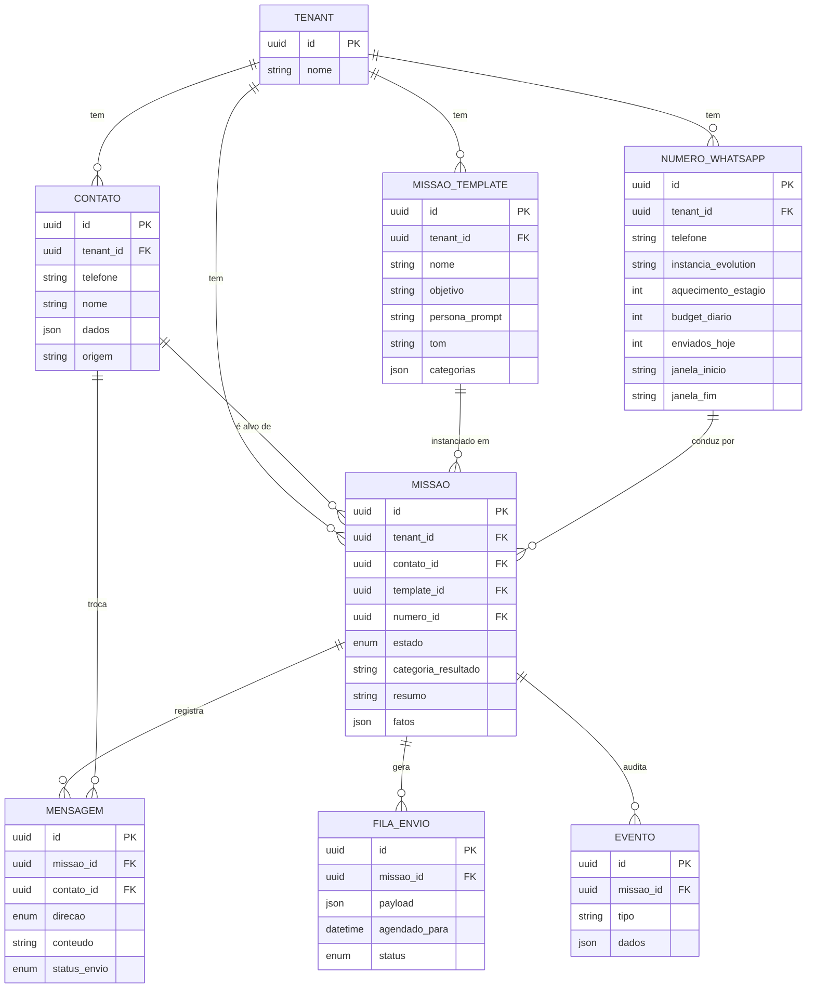

# zapagente — Modelo de Dados

> A camada 💛 **Domínio** virando 🔌 **persistência**. Expresso concretamente em **Prisma** (`apps/api/prisma/schema.prisma`).
> Base: [ARQUITETURA-TÉCNICA §2](estudos/ARQUITETURA-TECNICA.md). Regra transversal: **toda tabela tem `tenant_id`** (single-tenant hoje, white-label sem refatorar).

## Diagrama entidade-relacionamento (ERD)



## As 8 tabelas (o porquê de cada uma)

| Tabela | Papel | Ligações |
|---|---|---|
| **tenants** | Cliente/empresa dona dos dados (white-label). | raiz de tudo |
| **numeros_whatsapp** | Cada chip conectado + seu estado de **aquecimento/budget** (o que o motor anti-bloqueio lê). | tenant · missões |
| **contatos** | O lead: telefone, nome, `dados` livres (`jsonb`), origem. | tenant · missões · mensagens |
| **missao_templates** | Missão **reutilizável** ("botão"): objetivo, persona, tom, categorias. | tenant · missões |
| **missoes** | A **instância viva**: contato + número + estado + `fatos`/`resumo` (a memória). | contato · template · número |
| **mensagens** | Histórico por conversa (`in`/`out`, status, timestamps p/ ritmo). | missão · contato |
| **fila_envio** | O que está pra sair, **com atraso** (`agendado_para`) — o coração anti-bloqueio. | missão · contato |
| **eventos** | Trilha de auditoria/timeline (mudança de estado, escalada…). | missão |

**Relações-chave:** `contato 1—N missões` · `template 1—N missões` · `missão 1—N mensagens` · `número 1—N missões`.

## Aplicando o Prisma

O schema está em [`apps/api/prisma/schema.prisma`](../apps/api/prisma/schema.prisma). Convenção adotada:
- **Models em PascalCase**, **campos em camelCase**, mapeados pra colunas `snake_case` via `@map`/`@@map` (banco em português, código idiomático).
- **Enums** pro que é fechado: `EstadoMissao`, `Direcao`, `StatusEnvio`, `StatusConexao` — o banco valida o estado, não só a aplicação.
- **`Json`** pro que é flexível (`dados`, `fatos`, `categorias`, `payload`).
- **Índices** onde a fila e o pipeline consultam (`status + agendado_para`, `tenant_id + estado`).

Comandos (rodar de `apps/api/`, depois que o Postgres estiver de pé via Docker):
```bash
npm install
npx prisma migrate dev --name init   # cria as tabelas + gera o client
npx prisma studio                     # inspeciona os dados no navegador
```

> O `prisma migrate` só roda com um Postgres acessível — ele chega na **fatia 1 (Fundação)** junto do `docker-compose.yml`. Por ora, o schema é a fonte da verdade do modelo.

## Onde isso encaixa nas camadas

O Prisma Client é um **detalhe de Infraestrutura**. O Domínio não o importa direto: ele fala com **portas** (ex.: `RepositorioDeMissao`), e um adapter Prisma implementa a porta. Trocar Prisma por outra coisa um dia = reescrever só o adapter (ver [ARQUITETURA §1.1](ARQUITETURA.md)).
