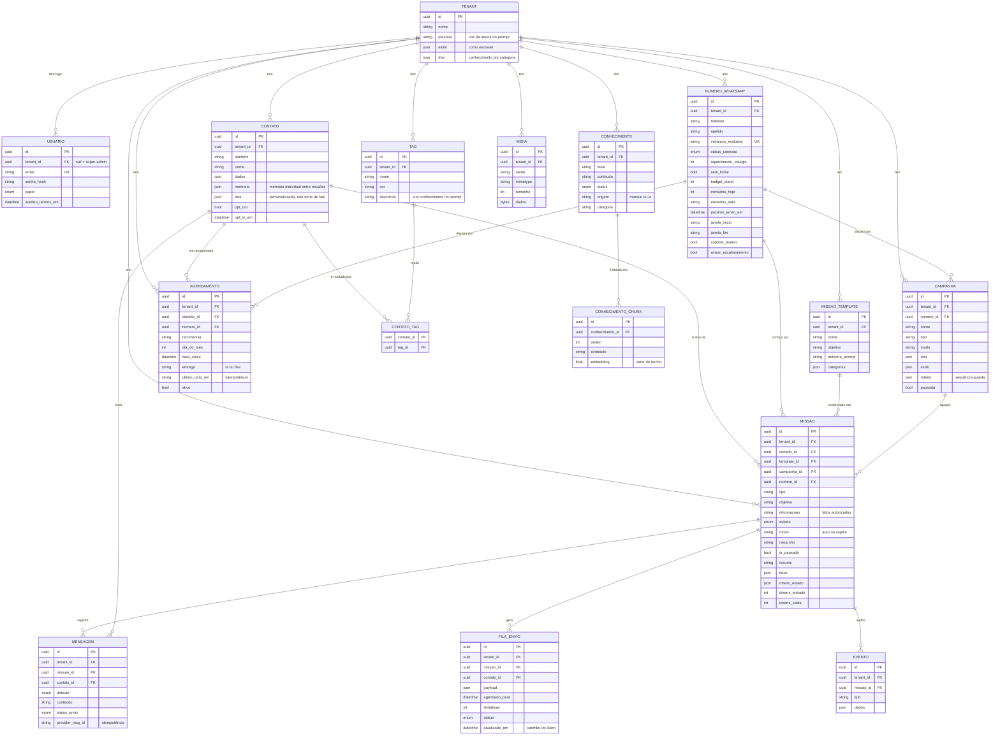

# Commagente — Modelo de Dados

> A camada 💛 **Domínio** virando 🔌 **persistência**, expressa em **Prisma**
> (`apps/api/prisma/schema.prisma` — a fonte da verdade, e o arquivo mais comentado do repo).
> Regra transversal: **toda tabela tem `tenant_id`**, e o isolamento é por linha.
>
> Este arquivo é o **mapa visual e as convenções**. Quem **escreve** e quem **lê** cada tabela
> está em [ARQUITETURA.md §9](ARQUITETURA.md#9--dados); o fluxo que produz esses dados, na §4 do
> mesmo documento.
>
> **Atualizado em 09/09/2026.** A versão anterior descrevia **8 tabelas** (e o README chegou a
> dizer 11): os dois números morreram. São **16 models** hoje.

## Diagrama entidade-relacionamento (ERD)



## As 16 tabelas, em quatro grupos

**Quem é quem (tenancy e acesso)**

| Tabela | Papel |
|---|---|
| `tenants` | O cliente da plataforma. Guarda também a **identidade da IA**: `persona` (voz), `estilo` (como escrever) e `dna` (o que a empresa sabe, por categoria) |
| `usuarios` | Login do painel. `tenant_id` nulo é super-admin. `aceitou_termos_em` é o aceite de LGPD do primeiro acesso |

**A operação de WhatsApp**

| Tabela | Papel |
|---|---|
| `numeros_whatsapp` | O chip: instância Evolution (**única no banco inteiro** — é assim que o webhook resolve o dono sem vazar entre tenants), estado de conexão, aquecimento, budget, janela, suporte reativo, aviso de escalonamento |
| `fila_envio` | O que está para sair, **com atraso** — o coração anti-bloqueio |
| `mensagens` | O histórico da conversa. `@@unique([tenantId, providerMsgId])` é a idempotência que impede processar a mesma mensagem duas vezes |
| `eventos` | A trilha de auditoria: turno da IA, escalada, erro, opt-out, chip caído, mídia enviada… |

**O CRM e o trabalho**

| Tabela | Papel |
|---|---|
| `contatos` | O lead. Telefone único por tenant; `memoria` (fatos que persistem entre missões), `dna` (perfil da pessoa) e o par opt-in / opt-out |
| `tags` + `contato_tags` | Segmentação. A **descrição da tag é conhecimento** injetado no prompt de quem a tem |
| `missoes` | A instância viva: contato + número + estado + memória + modo + estilo + DNA + progresso no roteiro + custo em tokens |
| `campanhas` | A mesma definição para N missões, com herança **ao vivo** de DNA, mídia, estilo e roteiro |
| `agendamentos` | Missão programada por contato: recorrência, entrega (`ia` conduz ou `fixa` só envia) e idempotência por ciclo |
| `missao_templates` | Missão reutilizável ("botão"). Herança do MVP; hoje o caminho comum são os **modelos** do painel |

**O que a IA sabe e envia**

| Tabela | Papel |
|---|---|
| `conhecimento` | A memória coletiva curada: `sugerido` (a IA propôs) → `aprovado` → servido. Pode pertencer a uma categoria do DNA |
| `conhecimento_chunks` | Os pedaços vetorizados de cada item aprovado. A busca é **cosseno em memória**, sem `pgvector` |
| `midia` | Os arquivos que a IA pode enviar (catálogo, tabela, PDF, áudio), guardados em `bytea` |

## Convenções do schema

- **Models em PascalCase**, **campos em camelCase**, mapeados para colunas e tabelas `snake_case`
  via `@map` e `@@map` — banco em português, código idiomático.
- **Enums** para o que é fechado: `EstadoMissao`, `Direcao`, `Papel`, `StatusConhecimento`,
  `StatusEnvio`, `StatusConexao`. O banco valida o estado, não só a aplicação.
- **`Json`** para o que é flexível e evolui sem migração: `dados`, `fatos`, `memoria`, `dna`,
  `estilo`, `roteiro`, `roteiro_estado`, `payload`, `categorias`.
- **Índices** onde a fila e o pipeline consultam: `status + agendado_para`, `tenant_id + estado`,
  `missao_id + criada_em`, `tenant_id + criada_em` (o monitoramento ao vivo sem full-scan).
- **Uniques que são regra de negócio**, não enfeite: `instancia_evolution` (anti-vazamento
  cross-tenant), `tenant_id + telefone` (um contato por número), `tenant_id + provider_msg_id`
  (idempotência — e `NULL`s são distintos, por isso `provider_msg_id` vazio é normalizado para
  `NULL`).
- **Cascade** só onde o filho não faz sentido sozinho: `conhecimento_chunks` e `contato_tags`.

## Migrações

São **42**, de `20260721022316_init` a `20260824180000_modo_roteiro`. Comandos, de `apps/api/`:

```bash
npx prisma generate                 # regenera o client depois de mexer no schema
npx prisma migrate dev --name algo  # DEV: cria a migração e aplica (interativo)
npx prisma migrate deploy           # BANCO COM DADO: só aplica o que falta
npx prisma studio                   # inspeciona os dados no navegador
```

> ⚠️ `migrate dev` é **interativo** e trava em ambiente headless (foi o que aconteceu ao criar a
> constraint de idempotência). Para constraint nova em banco com dado: escreva a migração à mão,
> confira duplicatas e use `migrate deploy`.

## Onde isso encaixa nas camadas

O Prisma Client é um **detalhe de Infraestrutura**. O Domínio não o importa: ele fala com portas e
com repositórios (`*.repo.ts`), e `core/db.ts` é o único lugar que instancia o client. Trocar o
Prisma um dia significaria reescrever só os repositórios — ver
[ARQUITETURA §3](ARQUITETURA.md#3--camadas-portas-e-o-harness).
