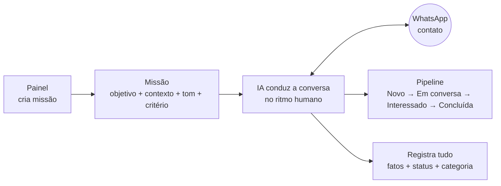
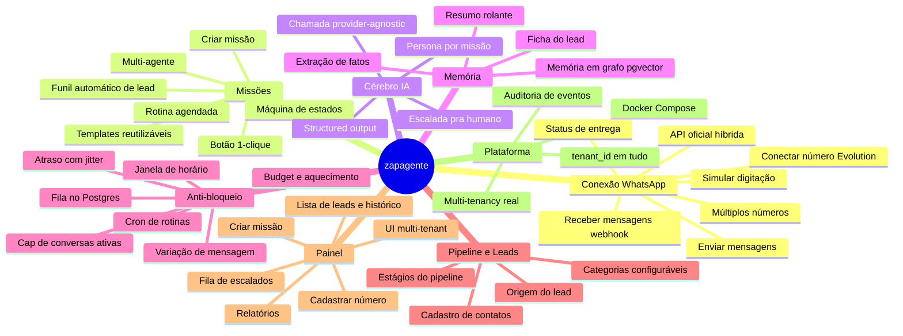
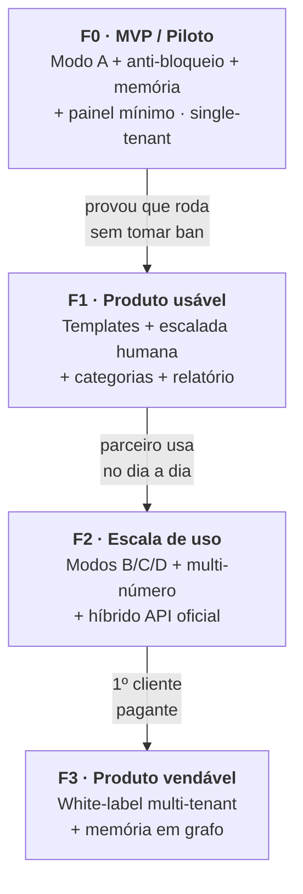

# zapagente — Roadmap & Divisão de Funcionalidades

> Consolida os estudos em [docs/estudos/](estudos/) numa visão única: **o que** o produto faz, **como** as funcionalidades se agrupam e em **que ordem** construir.
> Base: [ESTRUTURA](estudos/ESTRUTURA.md) · [DECISÕES](estudos/DECISOES-stack-arquitetura-roadmap.md) · [ARQUITETURA-TÉCNICA](estudos/ARQUITETURA-TECNICA.md) · [ESTUDO-memória-e-custo](estudos/ESTUDO-memoria-e-custo.md).

**Legenda de fase:** `F0` MVP/Piloto · `F1` Produto usável · `F2` Escala de uso · `F3` Produto vendável (white-label).

---

## 1. O produto em uma imagem

A unidade do sistema é **(número) + (missão)**. Você configura uma missão e "solta" a IA; ela conduz a conversa no ritmo humano e move o contato num pipeline até a missão ser cumprida.

---

## 2. As 4 formas de operar (modos)

| Modo | O que é | Fase |
|---|---|---|
| **A — Missão dirigida** | Eu escolho o contato e dou a missão; a IA toca a conversa. | ⭐ `F0` |
| **B — Funil automático** | Lead cai no sistema (indicação/lista) → qualificação automática. | `F2` |
| **C — Tarefa 1-clique** | Botão dispara missão pré-configurada (ex.: pedir água, cobrar relatório). | `F2` |
| **D — Rotina agendada** | Mensagens em dias/horários fixos (ex.: seg/qua/sex 09h). | `F2` |

---

## 3. Mapa de funcionalidades

Todo o produto, dividido em **8 grupos**. Cada folha é uma funcionalidade construível.

---

## 4. Funcionalidades por fase (matriz de construção)

Cada linha mapeia a funcionalidade → grupo → **bloco do backend** (ver [ARQUITETURA-TÉCNICA §1](estudos/ARQUITETURA-TECNICA.md)) → fase.

| Funcionalidade | Grupo | Bloco backend | Fase |
|---|---|---|---|
| Conectar número (sessão Evolution) | Conexão | Executor / Núcleo | `F0` |
| Receber mensagens (webhook) | Conexão | 1. Ingestor | `F0` |
| Enviar mensagens + status | Conexão | 6. Executor | `F0` |
| Simular digitação (presença) | Conexão | 6. Executor | `F0` |
| Criar missão (objetivo/contexto/tom/critério) | Missões | 7. API painel | `F0` |
| Máquina de estados da missão | Missões | 4. Máquina de estados | `F0` |
| Chamada LLM provider-agnostic | Cérebro IA | 3. Cérebro IA | `F0` |
| Structured output (estado/categoria/fatos) | Cérebro IA | 3. Cérebro IA | `F0` |
| Persona/prompt por missão | Cérebro IA | 3. Cérebro IA | `F0` |
| Ficha do lead (montador de contexto) | Memória | 2. Montador | `F0` |
| Extração de fatos | Memória | 2. Montador | `F0` |
| Fila no Postgres + worker | Anti-bloqueio | 5. Fila/agendador | `F0` |
| Budget por número + aquecimento | Anti-bloqueio | 5. Fila/agendador | `F0` |
| Janela de horário | Anti-bloqueio | 5. Fila/agendador | `F0` |
| Cap de conversas ativas | Anti-bloqueio | 5. Fila/agendador | `F0` |
| Atraso com jitter | Anti-bloqueio | 5. Fila/agendador | `F0` |
| Variação de mensagem | Anti-bloqueio | 3. Cérebro IA | `F0` |
| Contatos + estágios + categorias | Pipeline | 7. API painel | `F0` |
| Cadastrar número (UI) | Painel | Painel | `F0` |
| Criar missão (UI) | Painel | Painel | `F0` |
| Lista de leads + status + histórico | Painel | Painel | `F0` |
| Docker Compose (pg/evolution/api/painel) | Plataforma | Infra | `F0` |
| `tenant_id` em todas as tabelas | Plataforma | Infra | `F0` |
| Escalada pra humano (guardrail) | Cérebro IA | 3 + Painel | `F1` |
| Templates de missão reutilizáveis | Missões | 7. API painel | `F1` |
| Resumo rolante | Memória | 2. Montador | `F1` |
| Fila de escalados (humano assume) | Painel | Painel | `F1` |
| Relatórios | Painel | Painel | `F1` |
| Auditoria de eventos (timeline) | Plataforma | Infra | `F1` |
| Botão 1-clique (Modo C) | Missões | 4 + 7 | `F2` |
| Rotina agendada / cron (Modo D) | Missões | 5. Agendador | `F2` |
| Funil automático de lead (Modo B) | Missões | 4. Máquina de estados | `F2` |
| Múltiplos números | Conexão | 5 + 6 | `F2` |
| API oficial híbrida (inbound opt-in) | Conexão | 1 + 6 | `F2` |
| Multi-agente / múltiplas personas | Missões | 3. Cérebro IA | `F3` |
| Memória em grafo (pgvector) | Memória | 2. Montador | `F3` |
| Multi-tenancy real + UI white-label | Plataforma | Infra + Painel | `F3` |

---

## 5. Roadmap em fases

Regra de ouro: **cada fase só começa quando a anterior provou valor** (piloto → 1 cliente → 3 clientes → white-label).

---

## 6. Fase 0 (MVP) — o que construir primeiro

Escopo travado do piloto (Modo A + anti-bloqueio), em **fatias verticais** na ordem sugerida:

1. **Fundação** — repo, Docker Compose (postgres + evolution + api + painel), schema com `tenant_id`, config/env.
2. **Conexão** — conectar número na Evolution, webhook de entrada (Ingestor), envio de saída (Executor).
3. **Missão + estados** — criar missão pelo painel; máquina de estados (`configurada → na_fila → em_conversa → concluída/descartada/escalada/sem_resposta`).
4. **Cérebro IA** — chamada provider-agnostic + structured output (`resposta, novo_estado, categoria, fatos, precisa_humano`).
5. **Memória** — montador da ficha do lead (persona + objetivo + contexto + fatos + resumo + últimas ~8 msgs).
6. **Anti-bloqueio** — fila no Postgres, budget/aquecimento por número, janela de horário, cap de ativas, jitter, digitação simulada.
7. **Painel mínimo** — cadastrar número, criar missão, lista de leads com status/histórico.
8. **Piloto real** — rodar numa empresa do parceiro com número aquecido.

**Critério de "MVP pronto":** uma missão dirigida roda ponta a ponta num número aquecido, conduz a conversa no ritmo humano e move o lead pelo pipeline — **sem tomar bloqueio**.

---

## 7. Dependências externas (não dependem só do Pedro)

Antes/durante o F0, alinhar com o parceiro (ver [DECISÕES](estudos/DECISOES-stack-arquitetura-roadmap.md)):

- ⚖️ **Risco de ban aceito** — número dedicado + aquecimento (o chip pode cair).
- 🧑‍💼 **Specs da VPS** — confirmar RAM/CPU (alvo ~2 vCPU / 4 GB).
- 🧑‍💼 **n8n fora do core** — Node puro no crítico (recomendado).
- 💰 **Modelo mini da OpenAI** — escolher e estimar custo real do piloto.
- ⚖️ **Base morna, não fria** — a regra das 48h da Meta favorece começar com contatos que já responderam.
