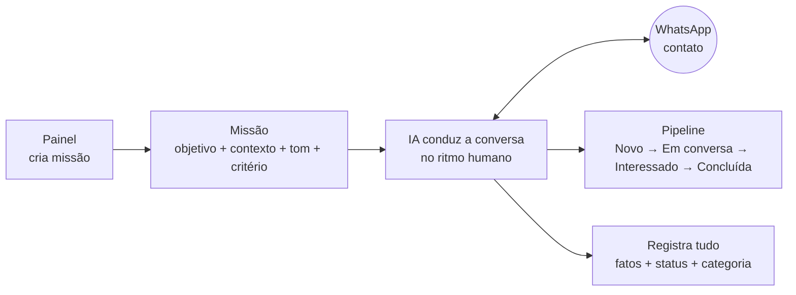
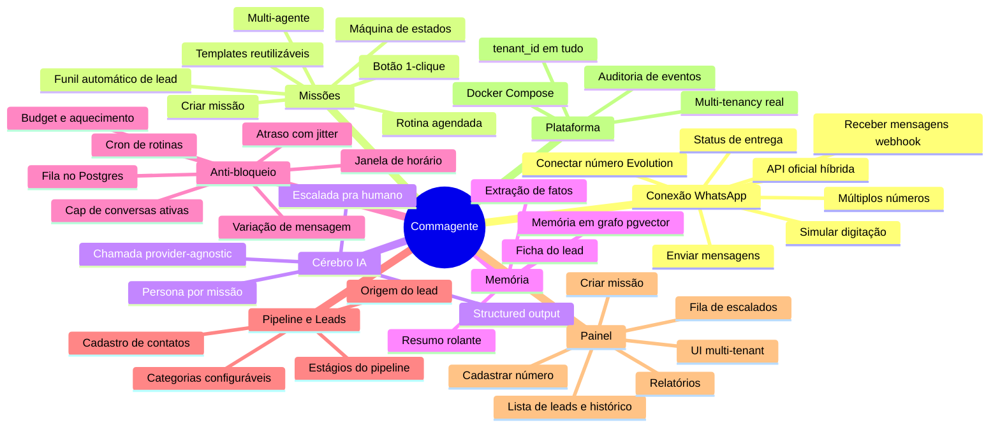
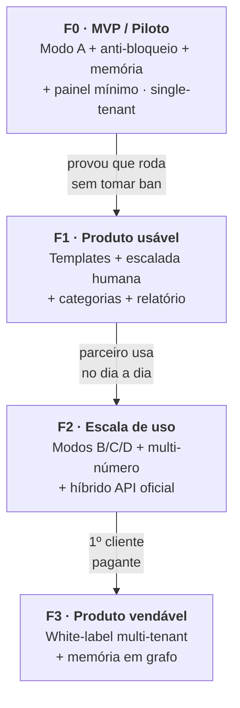

# Commagente — Roadmap & Divisão de Funcionalidades

> Consolida os estudos em [docs/estudos/](estudos/) numa visão única: **o que** o produto faz, **como** as funcionalidades se agrupam e em **que ordem** construir.
> Base: [ESTRUTURA](estudos/ESTRUTURA.md) · [DECISÕES](estudos/DECISOES-stack-arquitetura-roadmap.md) · [ARQUITETURA-TÉCNICA](estudos/ARQUITETURA-TECNICA.md) · [ESTUDO-memória-e-custo](estudos/ESTUDO-memoria-e-custo.md).

**Legenda de fase:** `F0` MVP/Piloto · `F1` Produto usável · `F2` Escala de uso · `F3` Produto vendável (white-label).

---

## 1. O produto em uma imagem

A unidade do sistema é **(número) + (missão)**. Você configura uma missão e "solta" a IA; ela conduz a conversa no ritmo humano e move o contato num pipeline até a missão ser cumprida.

---

## 2. As 4 formas de operar (modos)

| Modo | O que é | Fase |
|---|---|---|
| **A — Missão dirigida** | Eu escolho o contato e dou a missão; a IA toca a conversa. | ⭐ `F0` |
| **B — Funil automático** | Lead cai no sistema (indicação/lista) → qualificação automática. | `F2` |
| **C — Tarefa 1-clique** | Botão dispara missão pré-configurada (ex.: pedir água, cobrar relatório). | `F2` |
| **D — Rotina agendada** | Mensagens em dias/horários fixos (ex.: seg/qua/sex 09h). | `F2` |

---

## 3. Mapa de funcionalidades

Todo o produto, dividido em **8 grupos**. Cada folha é uma funcionalidade construível.

---

## 4. Funcionalidades por fase (matriz de construção)

Cada linha mapeia a funcionalidade → grupo → **bloco do backend** (ver [ARQUITETURA-TÉCNICA §1](estudos/ARQUITETURA-TECNICA.md)) → fase.

| Funcionalidade | Grupo | Bloco backend | Fase |
|---|---|---|---|
| Conectar número (sessão Evolution) | Conexão | Executor / Núcleo | `F0` |
| Receber mensagens (webhook) | Conexão | 1. Ingestor | `F0` |
| Enviar mensagens + status | Conexão | 6. Executor | `F0` |
| Simular digitação (presença) | Conexão | 6. Executor | `F0` |
| Criar missão (objetivo/contexto/tom/critério) | Missões | 7. API painel | `F0` |
| Máquina de estados da missão | Missões | 4. Máquina de estados | `F0` |
| Chamada LLM provider-agnostic | Cérebro IA | 3. Cérebro IA | `F0` |
| Structured output (estado/categoria/fatos) | Cérebro IA | 3. Cérebro IA | `F0` |
| Persona/prompt por missão | Cérebro IA | 3. Cérebro IA | `F0` |
| Ficha do lead (montador de contexto) | Memória | 2. Montador | `F0` |
| Extração de fatos | Memória | 2. Montador | `F0` |
| Fila no Postgres + worker | Anti-bloqueio | 5. Fila/agendador | `F0` |
| Budget por número + aquecimento | Anti-bloqueio | 5. Fila/agendador | `F0` |
| Janela de horário | Anti-bloqueio | 5. Fila/agendador | `F0` |
| Cap de conversas ativas | Anti-bloqueio | 5. Fila/agendador | `F0` |
| Atraso com jitter | Anti-bloqueio | 5. Fila/agendador | `F0` |
| Variação de mensagem | Anti-bloqueio | 3. Cérebro IA | `F0` |
| Contatos + estágios + categorias | Pipeline | 7. API painel | `F0` |
| Cadastrar número (UI) | Painel | Painel | `F0` |
| Criar missão (UI) | Painel | Painel | `F0` |
| Lista de leads + status + histórico | Painel | Painel | `F0` |
| Docker Compose (pg/evolution/api/painel) | Plataforma | Infra | `F0` |
| `tenant_id` em todas as tabelas | Plataforma | Infra | `F0` |
| Escalada pra humano (guardrail) | Cérebro IA | 3 + Painel | `F1` |
| Templates de missão reutilizáveis | Missões | 7. API painel | `F1` |
| Resumo rolante | Memória | 2. Montador | `F1` |
| Fila de escalados (humano assume) | Painel | Painel | `F1` |
| Relatórios | Painel | Painel | `F1` |
| Auditoria de eventos (timeline) | Plataforma | Infra | `F1` |
| Botão 1-clique (Modo C) | Missões | 4 + 7 | `F2` |
| Rotina agendada / cron (Modo D) | Missões | 5. Agendador | `F2` |
| Funil automático de lead (Modo B) | Missões | 4. Máquina de estados | `F2` |
| Múltiplos números | Conexão | 5 + 6 | `F2` |
| API oficial híbrida (inbound opt-in) | Conexão | 1 + 6 | `F2` |
| Multi-agente / múltiplas personas | Missões | 3. Cérebro IA | `F3` |
| Memória em grafo (pgvector) | Memória | 2. Montador | `F3` |
| Multi-tenancy real + UI white-label | Plataforma | Infra + Painel | `F3` |

---

## 5. Roadmap em fases

Regra de ouro: **cada fase só começa quando a anterior provou valor** (piloto → 1 cliente → 3 clientes → white-label).

---

## 6. Fase 0 (MVP) — o que construir primeiro

Escopo travado do piloto (Modo A + anti-bloqueio), em **fatias verticais** na ordem sugerida:

1. **Fundação** — repo, Docker Compose (postgres + evolution + api + painel), schema com `tenant_id`, config/env.
2. **Conexão** — conectar número na Evolution, webhook de entrada (Ingestor), envio de saída (Executor).
3. **Missão + estados** — criar missão pelo painel; máquina de estados (`configurada → na_fila → em_conversa → concluída/descartada/escalada/sem_resposta`).
4. **Cérebro IA** — chamada provider-agnostic + structured output (`resposta, novo_estado, categoria, fatos, precisa_humano`).
5. **Memória** — montador da ficha do lead (persona + objetivo + contexto + fatos + resumo + últimas ~8 msgs).
6. **Anti-bloqueio** — fila no Postgres, budget/aquecimento por número, janela de horário, cap de ativas, jitter, digitação simulada.
7. **Painel mínimo** — cadastrar número, criar missão, lista de leads com status/histórico.
8. **Piloto real** — rodar numa empresa do parceiro com número aquecido.

**Critério de "MVP pronto":** uma missão dirigida roda ponta a ponta num número aquecido, conduz a conversa no ritmo humano e move o lead pelo pipeline — **sem tomar bloqueio**.

---

## 7. Dependências externas (não dependem só do Pedro)

Antes/durante o F0, alinhar com o parceiro (ver [DECISÕES](estudos/DECISOES-stack-arquitetura-roadmap.md)):

- ⚖️ **Risco de ban aceito** — número dedicado + aquecimento (o chip pode cair).
- 🧑‍💼 **Specs da VPS** — confirmar RAM/CPU (alvo ~2 vCPU / 4 GB).
- 🧑‍💼 **n8n fora do core** — Node puro no crítico (recomendado).
- 💰 **Modelo mini da OpenAI** — escolher e estimar custo real do piloto.
- ⚖️ **Base morna, não fria** — a regra das 48h da Meta favorece começar com contatos que já responderam.

---

## 8. Backlog & próximas capacidades (pós-teste Costa Doce · 2026-07-22)

Itens levantados no teste ao vivo (ver [aprendizados-teste-costa-doce](aprendizados-teste-costa-doce.md)).

### 8.1 📚 Biblioteca de documentos do tenant — ingestão + RAG + envio pela IA `F2`
**O cliente sobe os próprios materiais** (docx/pdf/imagem): catálogos, **menus/cardápios**, tabelas, materiais de expedição (informativo, roteiro, logística), contratos. O sistema então:
- **(a) Vira fonte da verdade** — transforma o documento em **Conhecimento** consultável (curado e, na evolução, **RAG**: a IA busca o trecho relevante sozinha). Substitui o processo manual de hoje (alguém destila o doc e cola texto em `informacoes`/`Conhecimento`).
- **(b) A IA ENVIA o arquivo ao cliente** na hora certa (ex.: mandar o cardápio, o catálogo, o PDF da expedição) — como foi feito com o PDF da Costa Doce no teste.
- Escopo por tenant (a biblioteca é do cliente); pastas/categorias (ex.: reaproveitar a taxonomia do Mini Drive: Expedições/Artes/Institucional).

> **Já feito:** (1) a IA **enviar arquivo/mídia** ao contato (`enviarDocumento` / `sendMedia`); (2) **ingestão versão (a)** — subir PDF/DOCX/TXT no painel (aba Conhecimento → "Importar documento") → extrai o texto (`core/documentos/extrair-texto`, pdf-parse/mammoth) → vira uma entrada de **Conhecimento** do tenant; (3) ✅ **versão (b) RAG** — `core/embeddings/` (text-embedding-3-small, cosseno em memória) + `ConhecimentoChunk`: cada item aprovado é fatiado e vetorizado; o harness injeta **só os trechos relevantes** (fallback p/ tudo quando embeddings off). **Falta:** a **UI de biblioteca por pastas/categorias** + suporte a imagem (OCR).

### 8.2 💸 Otimização de custo do LLM `F1`
Custo hoje é baixíssimo (~R$0,06 numa conversa longa de 27 turnos), mas dá pra cortar:
- ✅ **Throttle do resumo (COST-2)** — `resumir` agora roda a cada 3 turnos (ou ao concluir), não todo turno. Corta ~1/3 das chamadas.
- ✅ **RAG em vez de contexto fixo (RAG-1)** — o conhecimento vai por **trechos relevantes** (não a base inteira) em cada `gerar`; escala a base sem inflar o prompt.

### 8.3 📊 Instrumentação de custo & escala `F1`
- ✅ **(COST-1)** — captura o `usage` (tokens in/out) de cada chamada OpenAI **por missão** (`Missao.tokensEntrada/tokensSaida`) e exibe no detalhe da missão (card "Custo de IA", **só super-admin**, escondido no servidor p/ não-super). **Falta (evolução):** agregado por tenant/dia num dashboard.
- **Baseline medido:** ~US$0,01 (~R$0,06) por conversa longa → **~R$60 / 1.000 conversas**. A IA é barata; o custo real é infra + chip + trabalho. Serve pra precificar a revenda com margem clara.

### 8.4 🚀 Deploy "always-on desassistido" (bloqueadores de produção) `F1`
> Levantado na revisão 360° (2026-07-23). "Deploy" não é só subir o código — é **sobreviver em produção sem babá**. Além dos P0 de segurança já conhecidos (segredo no webhook, helmet/rate-limit/CORS, segredos fortes, rodar `backfill-rag.mts` 1×), faltam:
- **Observabilidade/alerta** — alertar quando `statusConexao != conectado` (chip caiu), `classificarSaude = risco`, e um heartbeat do worker. Hoje uma queda é silenciosa até o parceiro perceber que parou. Falha #1 esperada em produção.
- **Backup do Postgres** — hoje **ZERO backup**. `pg_dump` em cron + cópia off-site. Um VPS único com dados multi-tenant (contatos, conversas, consentimento LGPD) sem backup = perda total numa falha de disco. Bloqueador antes de dado real de cliente.
- **Teto de gasto da OpenAI** — a key é do parceiro, **única e compartilhada**. Setar limite hard + alerta na conta antes de rodar always-on (loop/abuso gasta sem freio).
- **Proteger a Evolution API** (:8080) — sobe junto no compose; se exposta, é vetor direto pro WhatsApp. Só acessível na rede interna/localhost + key forte.

### 8.5 💼 Camada comercial (pré-revenda) `F2`
> Lacuna estratégica da revisão: o roadmap tratava "multi-tenant técnico" como sinônimo de "vendável". O **encanamento** existe (isolamento, super-admin, impersonação); a **camada comercial** não. Sem ela, revender é manual e arriscado:
- **Estado + billing do tenant** — `Tenant` só tem `id/nome/criadoEm`. Falta `ativo` (cortar quem não paga) + `plano` + integração de cobrança BR (Asaas/Pagar.me/Stripe).
- **Quotas por tenant (entitlements de plano)** — hoje os limites são por número (budget/cap/teto de estágio), não por tenant (nº de números, missões/mês, contatos, quais features). Base pra diferenciar planos e conter custo.
- **Custo + teto por tenant** — COST-1 é por-missão; falta agregado por tenant e **corte automático** ao estourar (protege a key única do parceiro).
- **Gestão de usuários por tenant + reset de senha** — hoje `criarTenant` cria 1 admin; o cliente não adiciona operadores nem reseta senha sem mexer no banco.
- **Branding white-label** (logo/cor/domínio por tenant) e **hard-delete LGPD** (direito ao apagamento de contato+mensagens; hoje só opt-out).

> ⚠️ **Riscos de produção** (revisão): dependência da API não-oficial + "Aguardando esta mensagem" (dessincronização Signal com status `ok`) → mitigação é a escada oficial, mas **sem gatilho definido**; **chip único sem pool de rotação** (ponto único de ban); key OpenAI única do parceiro; **capacidade** da VPS 2vCPU/4GB apertada com Postgres+Evolution+Redis+API (RAG por cosseno em memória cresce com a base → pgvector antes do que se imagina).

### 8.6 🏷️ Tags/segmentação de contatos (CRM) `F1`
> Pedido do Pedro (2026-07-23). Hoje a audiência de uma campanha/missão é montada contato-a-contato (picker `SeletorContatos` + colar lista + "selecionar todos"). Falta **rotular contatos com tags** e disparar por segmento.
- **Marcar contatos com tags** (ex.: `lead-quente`, `costa-doce`, `inadimplente`, `cliente-2025`) — 1 contato pode ter N tags; gerenciar na página **Contatos** (adicionar/remover tag, filtrar a lista por tag).
- **Criar missão/campanha mirando uma tag** → dispara pra **todos os números daquela tag** de uma vez (reusa `criarMissaoEmLote`). O `SeletorContatos` ganha um filtro/atalho "todos da tag X".
- Atribuir tag **em lote** (na importação CSV/WhatsApp e via seleção múltipla). Respeita opt-out.
- **Esboço técnico:** model `Tag` (tenant-scoped) + N:N `ContatoTag`; `GET /contatos?tag=`; a criação de campanha aceita `tagId` como fonte de contatos. Casa com Contatos-CRM + Campanhas já existentes. **FEITO 2026-07-23 (TAG-1/2).**

### 8.7 ✏️ Edição em massa + experiência campanha↔missão `F1`
> Dúvida/pedido do Pedro (2026-07-24). Hoje cada missão é independente e editável 1 a 1 (objetivo/tom/informações/critério, reflete no próximo turno), mas NÃO há edição em lote nem visão unificada.
- **Editar em massa** o tom/objetivo/informações de **todas as missões de uma campanha** (ou de uma **tag**) de uma vez — ex.: "lancei a campanha com tom agressivo e quero suavizar em todas". Hoje seria contato a contato. Cuidado: só faz sentido aplicar às missões ainda **em andamento** (não reescrever conversas concluídas).
- **Unificar a EXPERIÊNCIA campanha↔missão** (UX, não arquitetura): manter a **missão como unidade atômica por baixo** (estado/memória próprios), mas apresentar numa tela "Conversas" com **toggle "agrupar por campanha"**; a campanha vira um **grupo + definição salva** (com placar). Mata a sensação de "por que tem duas telas?". Avaliar antes de investir — a separação atual (operar conversa × gerir lote) tem sua lógica.

### 8.8 🧭 Alinhamento 26/07 (Pedro × parceiro) + auditoria de código — **IMPLEMENTADO 27/07** `F1`

> ✅ **STATUS (27/07) — feito na branch `feat/backlog-alinhamento-2607` (typecheck 0 nos 2 apps · migrations aplicadas · smoke ponta a ponta com dublê OK):** **(1)** disparo em lote real — "Disparar campanha"/"Iniciar N configuradas" com relatório e guardas anti-ban; **(2)** alvo por tag no backend — missão/campanha miram `tagId` e o servidor resolve o segmento INTEIRO (+ opção "toda a tag" no seletor); **(3)** **persona no nível do tenant** — `Tenant.persona` sempre no prompt (montarPersona) + card "Identidade da IA" na tela Conhecimento; **(4)** **termos no 1º login** — aceite (uso de dados + responsabilidade do número) com modal bloqueante + timestamp; **(5)** **vigia** — alertas de número em risco de bloqueio / sem atividade 24h no dashboard (sem canal externo). **Adiados (com justificativa):** métricas por-vendedor (falta a dimensão "operador" no modelo + é pós-validação), notificação de escalonamento no WhatsApp (só validável com o chip conectado), mídia em campanha (maior risco de ban).

> Reunião de virada (ata `alinhamento 26.07`, ~88min) + **auditoria do código real** (2026-07-26). Contexto de negócio que fixa prazo: **ProAuto** (dono Lucas, autopeças/industrial ~R$40–50M) é o **cliente-âncora**; **teste numa vendedora**; **reunião QUARTA-FEIRA** pra integrar. Sociedade rumo a **50/50** + salário-ponte ~R$4k. **Rename do produto** (multicanal: WhatsApp+Insta+e-mail → fugir de "zap"; Hermes checado e **descartado** — domínio/nicho lotado).

**Auditoria — o que a ata deu como "pronto" × o que o código faz de verdade:**

| Ponto | Realidade | Veredito |
|---|---|---|
| Campanha "aperta e dispara pra todos" | `criarCampanha`/`criarMissaoEmLote` só **cria** missões em `configurada`; quem gera opener+enfileira é `iniciarMissao`, **1 a 1**. **Sem "iniciar em lote".** | ⚠️ **PARCIAL — GAP nº1** |
| Tag → dispara pros números da tag | Marca/filtra OK; alvo por tag só resolve a lista **no navegador** (sem endpoint `tagId`) + herda o gap acima | ⚠️ PARCIAL |
| Vigia por tenant (alerta "não falou com X") | **Não existe** (só throttle de saúde por número + watchdog anti-freeze do worker) | ❌ NÃO EXISTE |
| Escalonamento no WhatsApp do vendedor | Só aparece no **inbox do painel** (Escalados). Mandar aviso pro próprio número = a confirmar se a API topa | ❌ (é melhoria) |
| Campanha texto/imagem/áudio | Envio só faz **texto + PDF**; imagem/áudio de saída não existem | ⚠️ só texto/PDF |
| Métricas pro dono (por vendedor/vendas) | Só volume/pipeline **agregado**; sem dimensão por-vendedor, sem "vendas via sistema", sem custo agregado | ⚠️ PARCIAL |
| Tom/persona | Existe, mas **por missão** (`Missao.tom`); **não há persona por tenant**; `MissaoTemplate.personaPrompt` está **inerte** (montador não lê) | ✅ por missão |
| Termos de uso 1º login | Não existe | ❌ NÃO EXISTE |
| Cap ~30/dia | Existe e é aplicado no envio — mas **default é 10/dia** (30 é o chip de teste) | ✅ (nº difere) |
| Escalonamento / memória ind.+coletiva / import CSV / programadas | Conferidos, funcionam | ✅ OK |

**Backlog priorizado (amanhã):**
1. **🥇 Disparo em lote de verdade** — botão "iniciar campanha/todas" que chama `processarTurno` pras missões `configurada`. É o buraco nº1 e o que o parceiro imagina como "campanha". **Seguro:** o worker anti-ban já espaça os envios (não sai rajada).
2. **🥈 Persona no nível do tenant** (ver nota abaixo) — o "doc de persona" da ata. Alto valor, baixo custo. Quick win pra quarta.
3. **🥉 Alvo por tag no backend** (`tagId` como fonte de contatos da missão/campanha) — fecha o fluxo "tag → dispara" junto do nº1.
4. **Termos de uso no 1º login** (aceite de dados + responsabilidade do número) — prometido pra quarta; proteção LGPD real. Quick win.
5. **Notificação de escalonamento fora do painel** (pro próprio número / e-mail) — depende de confirmar se a API manda pro próprio número.
6. **Métricas por vendedor + relatório pro dono** — faz sentido, mas **depois da validação** (precisa de dimensão "operador" nas stats + parâmetros do dono; é o mais caro de IA → ideia do "relatório pago R$5–15").
7. **Vigia por tenant** (alerta operacional) — médio, não bloqueia a quarta.
8. **Mídia em campanha (imagem/áudio)** — só sob pedido; é o **maior risco de ban** (o próprio Pedro alertou). Baixa prioridade.

> **🎭 Nota de design — persona (ideia do Pedro: "formulário de persona dentro de Conhecimento"):** a intuição está certa, mas **NÃO** pode ser um item da base de Conhecimento (RAG) — conhecimento é **fato recuperado por relevância** (pode não ser puxado) e persona precisa estar **SEMPRE** no system prompt. Desenho certo: campo **`Tenant.persona`** (ou mini-formulário: tratamento você/tu/sr · formalidade · emojis · tamanho · assinatura · instruções livres) **compilado numa frase** e injetado sempre no `montarPersona` como voz-base, com `Missao.tom` fazendo override pontual. **Pode viver na tela Conhecimento**, mas como **card separado "Identidade da IA"**, não na lista. Funciona (o mecanismo já roda hoje via `tom` por missão); só estamos elevando pra reutilizável por tenant. Ganho pro ProAuto: define a persona da vendedora **uma vez** → **toda missão herda**.

> ⚠️ **Pra não queimar na quarta:** os 3 itens que a ata deu como "prontos" mas estão PARCIAL/inexistentes — **campanha que dispara sozinha**, **vigia**, **escalonamento no WhatsApp da vendedora** — não devem ser prometidos como prontos na demo ProAuto.

### 8.9 📋 Relatórios por missão e por campanha (consolidação + síntese por IA) `F1`

> Pedido do Pedro (2026-07-29). **Caso de uso central:** um **gerente cria uma missão pra falar com N colaboradores** (ex.: confirmar disponibilidade do sábado, coletar feedback de cliente, levantar pendências/equipamento) **e recebe as informações de todos reunidas num relatório** — por missão individual **e** consolidado por campanha. Arquiteturalmente é o `Campanha` que já temos (1 definição → N missões-conversa, uma por contato) **+ uma camada de relatório que hoje não existe**. Forte diferencial de venda: gerente coordenando equipe/leads e recebendo o relatório pronto (bom de mostrar pro ProAuto).

**O que já existe (a matéria-prima — nada se perde hoje):** cada missão já captura e persiste `fatos` (Json — o que a IA descobriu sobre o contato, via `fatos_novos` mesclado a cada turno), `resumo` (resumo rolante), `resultado` + `categoriaResultado` (desfecho ao concluir) e `estado`. Por campanha existe só o **placar** (contadores concluídas/perdidas/ativas + taxa). **O que falta é consolidar o CONTEÚDO** num relatório e sintetizá-lo — a coleta em si já roda.

**O gap:**
1. **Consolidação** — reunir `fatos`/`resumo`/`resultado`/`estado` de todas as missões (de uma campanha, ou de uma **tag** §8.6) numa tabela: **linhas = contatos, colunas = campos coletados**; + o relatório individual por missão.
2. **Síntese por IA** — novo `ProvedorIA.sintetizar(dados)`: recebe os fatos/resumos de todas as missões e devolve um relatório narrativo ("8 de 10 confirmaram presença; 3 pediram equipamento; ponto recorrente: X"). Consome tokens → **candidato natural ao "relatório pago R$5–15"** (§8.8#6, que esta seção subsume).
3. **Campos a coletar (coleta estruturada)** — hoje `fatos_novos` é livre (`z.record`); pra o relatório sair consistente entre conversas, o gerente **declara os campos** (ex.: "disponibilidade sábado", "equipamento faltando", "orçamento"). O montador instrui a IA a preencher *essas* chaves → tabela alinhada + **placar de coleta** (quantos campos preenchidos por conversa).
4. **Export** — CSV (colunas de fatos) e **PDF branded** (receita RYZE de Chrome headless já existe).

**Plano de implementação (2 estágios):**
- **MVP `F1` — reusa 100% do que já é salvo, sem migration:** `GET /campanhas/:id/relatorio` + `GET /missoes/:id/relatorio` (agregam `fatos`/`resumo`/`resultado`/`estado`); tela **"Relatório"** na Campanha e na missão (tabela contatos × campos + resumos + desfechos); botão **"Consolidar com IA"** (`ProvedorIA.sintetizar`, provider-agnostic + dublê); export **CSV**.
- **Completo `F2` — relatório forte e consistente:** campo **`camposColeta`** na `Campanha`/`Missao` (lista nome+tipo) → persona instrui a coleta daqueles campos → tabela consistente + **placar de coleta**; **PDF branded**; filtros/pivô; **relatório recorrente** (casa com Missões Programadas — "toda sexta, resumo da semana").

**Encaixe técnico:** MVP = **zero modelo novo** (só endpoints de agregação + `sintetizar` em `core/ia` + telas no painel). O `camposColeta` (estágio completo) = 1 migration + ajuste no montador/prompt. Reusa `Campanha` + `Tags` (§8.6) + `Programadas`. Respeita multi-tenant (relatório escopado ao tenant, custo da síntese só-super no card de custo).

### 8.10 🔭 Monitoramento ao vivo por tenant (super-admin) `F1`

> Pedido do Pedro (2026-07-29), motivado pela entrada do **ProAuto**: "a partir do momento em que o cliente conecta o número, quero monitorar de perto — uso, conversas, tempo de resposta, TUDO." **Decisão: mora no PAINEL, só super-admin, por tenant** (não é algo que o cliente vê; o super-admin já enxerga todos os tenants; reusa dados que já logamos → zero infra nova). Consolida e estende §8.3 (custo) e §8.4 (observabilidade/alerta).

**Já capturado (a base):** `eventos` (log de tudo com timestamp: `turno_ia`, `suporte_reativo`, `escalada`, `erro_ia`, `chip_desconectado`, `chip_caido`, `audio_transcrito`…), `mensagens` (in/out com `criada_em` + `enviada_em` + `status_envio`), tokens por missão (§8.3), vigia + reconciliador (§8.4). Super-admin já vê conversa por missão via impersonação.

**O que falta (o "TUDO"):**
1. **Tempo de resposta** — o dado existe (`mensagens`), mas ninguém agrega. ⚠️ **Medir DOIS tempos separados:** (a) *processamento* = inbound.`criada_em` → reply.`criada_em` (debounce 7s + IA ~2-5s); (b) *até entrega* = inbound → reply.`enviada_em` (**inclui o atraso anti-ban 12-30s+, que é INTENCIONAL**). Não separar faz o disfarce humano parecer "lentidão". Mostrar p50/p95 dos dois.
2. **Feed ao vivo do tenant** — um fluxo único ("o que rola agora") lendo `eventos`+`mensagens`, em vez de abrir missão a missão.
3. **Push em tempo real** — hoje é poll no dashboard; alertar (1ª conversa, escalada, erro, chip caiu, resposta > SLA) por canal (WhatsApp self-send / e-mail / Telegram). Estende o vigia (§8.4).

**Plano:**
- **MVP `F1` (sem modelo novo):** seção **"Monitoramento"** (só super-admin), por tenant: cards de volume (msgs in/out, conversas ativas, missões por estado), **tempo de resposta p50/p95** (processamento × entrega), taxa de escalada/erro, saúde do chip, custo (tokens/R$); **feed ao vivo** (últimos eventos+mensagens, auto-refresh). Endpoints `GET /admin/monitor/:tenantId` (agrega `eventos`/`mensagens`/tokens).
- **Completo `F2`:** push de alertas (reusa/estende vigia) + SLA de tempo de resposta configurável + drill-down por conversa + export. **Camada de BI externa (Metabase/Grafana sobre o Postgres)** fica pra quando o **DONO do cliente** quiser self-service (não pro operador).

**Ponte pra hoje (sem construir):** enquanto a ferramenta não existe, o monitoramento ao vivo do ProAuto é feito **direto no banco** (tail de `eventos`/`mensagens` + cálculo de tempo de resposta via SSH), disparado no instante em que o chip conecta.

### 8.11 🧬 Visão de produto do parceiro (11 itens) + avaliação + princípio de INTERCALAR `F1/F2`

> Fonte: documento **"Melhorias e recursos sistema"** do parceiro (03/08/2026), escrito **após uso real** — visão de produto densa e coerente. **Tese central:** tudo gira em torno de **"DNA"** = base de conhecimento **hierárquica e categorizada** (Principal → Campanha → Missão → Contato) com controle **Herdar/Combinar/Substituir** por categoria. **Não é pivô** — formaliza/aprofunda o que já temos (persona + Conhecimento/RAG + memória do contato + contexto em camadas). Naming dele: "ComAgente" (é **Commagente**).

**Os 11 itens × estado atual:**

| # | Item | Estado | Onde encaixa |
|---|---|---|---|
| 1 | **Tags Inteligentes** (tag com *descrição que vira contexto pra IA*) | 🟡 parcial | §8.6 (tags existem); falta descrição-como-conhecimento |
| 2 | **Apelido dos números** (nome por chip em todo lugar) | 🔴 novo (simples) | `NumeroWhatsapp.apelido` + UI |
| 3 | **Recorrências completas** (diário/a-cada-X/semanal/anual/dias-úteis…) | 🟡 base pronta | expandir `Agendamento` (hoje só uma-vez/mensal — dor exata do parceiro) |
| 4 | **DNA** (renomear "Voz da Marca" + categorias) | 🟢 **FEITO** (§8.13) | `Tenant.dna` 10 categorias, defaults-first + orçamento de contexto; deployado prod |
| 5 | **DNA do Contato** (Perfil/Comunicação/Histórico/Observações) | 🟢 **FEITO** (§8.13) | `Contato.dna` 4 categorias, personalização (não fato); deployado prod |
| 6 | **Relatórios Inteligentes** (Analítico + Executivo/IA + chat da campanha) | 🟢 **núcleo FEITO** (§8.9) | falta o **chat da campanha** + indicadores ricos |
| 7 | **Central de Inteligência** (chat global sobre TODA a base) | 🔴 novo, grande | épico próprio; relaciona a §8.10 |
| 8 | **Tutorial Inteligente** (mascote guia a UI) | 🔴 novo (front-heavy) | adoção/suporte |
| 9 | **DNA Hierárquico** (Herdar/Combinar/Substituir, 4 níveis) | 🔴 novo/arquitetural | **coração da visão**; depende do #4 |
| 10 | **Assistente Virtual** (DNA próprio + avatar + inbox + modo exec.) | 🟡 parcial | Suporte Reativo (IMP-2) é a base |
| 11 | **Arquitetura Multiagente** | 🟡 parcial/conceitual | vários "agentes" já são features; ver caution abaixo |

**⚠️ AVALIAÇÃO CRÍTICA (os contras a gerenciar — não ignorar):**
1. **Config-rica × usuário-simples.** DNA = 4 níveis × 12 categorias × 3 modos = superfície enorme. Cliente de PME **não preenche formulário gigante** → **desenhar DNA defaults-first** (preenche o Principal, o resto herda; só mexe no que quer). Sem isso, colapsa na própria complexidade.
2. **"Mais contexto ≠ mais inteligente" (verdade de LLM).** Empilhar Principal+Campanha+Missão+Contato+Tags+histórico em toda mensagem = **mais caro, lento e PIOR** (diluição / lost-in-the-middle). Exige **orçamento de contexto + RAG** (puxar só o relevante), não "jogar tudo dentro".
3. **A metade omitida = entrega/anti-ban/custo.** O doc é 100% cérebro; **não toca** no que decide a sobrevivência (o "aguardando", ban do chip, teto de custo). A IA mais genial não vale nada se a msg não chega. → ver §8.4 (entrega/observabilidade) + escada oficial + §8.5 (custo/comercial).
4. **Multiagente (Item 11) = features, não framework.** Boa narrativa de venda; na prática construir as *funções* (relatório/aprendizado/assistente), não um framework de "agentes conversando" (muito já existe). Evitar arquitetura-pela-arquitetura.
5. **Central de Inteligência (Item 7)** = o mais difícil/arriscado/menor-ROI-curto — **item tardio, escopo apertado** (começar com consultas estruturadas, não "pergunte qualquer coisa"). Sem priorização/dependências no doc; exemplos com viés industrial (mundo do parceiro).

**🔁 PRINCÍPIO DE INTERCALAR (a regra de sequenciamento acordada):** pra cada bloco de **"cérebro"** entregue (relatório, DNA, assistente) entra um bloco de **"pneu"** (entrega/estabilidade/API oficial/teto de custo). Valor visível sempre + não construir na areia. Mensagem-alinhamento enviada ao parceiro 03/08. **Ordem de dependência real:** DNA (#4) → antes de tags-contexto (#1), DNA-contato (#5), hierarquia (#9), assistente (#10) e multiagente (#11); relatórios (#6) já tem núcleo; Central (#7) e Tutorial (#8) por último.

### 8.12 🗺️ Plano de FASES intercaladas (cérebro × pneu) `execução`

> Operacionaliza §8.11 + o princípio de intercalar. Cada fase entrega **um bloco de inteligência (parceiro) + um de confiabilidade ("pneu")** — valor visível sempre, sem construir na areia. Dependência-chave: **DNA base (#4) antes de #5/#9/#10**; #1 e #3 são independentes (quick wins). Trabalho na branch `feat/parceiro-melhorias` (backup: tag `backup-pre-parceiro-2026-08-03`).

**Fase 0 — Base (JÁ ENTREGUE):** Relatórios inteligentes núcleo (#6, prod) · HTTPS Caddy+sslip (prod) · **Apelido dos números (#2, na branch)**.

**Fase 1 — "Inteligência rápida + proteger o bolso":**
- 🧠 **#1 Tags-como-contexto** (descrição da tag → prompt, SÓ as do contato)
- 🧠 **#3 Recorrências completas** (diário/a-cada-X/semanal/anual/dias-úteis/data-fim/máx-execuções)
- 🛞 **Teto de gasto OpenAI + alerta de custo por tenant** (§8.4/§8.5 — protege a key do parceiro) · merge+deploy do #2
- ➡️ Entregável: tags inteligentes + agendamento completo no ar, custo sob controle.

**Fase 2 — "A fundação (DNA) + começar o oficial":**
- ✅ **#4 DNA** (categorias + rename "Voz da Marca"→DNA) — **FEITO e no prod** (§8.13): defaults-first + orçamento de contexto, Regras de Negócio prioritárias sem furar o anti-invenção.
- ✅ **#5 DNA do Contato** (monta sobre o #4) — **FEITO e no prod** (§8.13): `Contato.dna` 4 categorias (perfil/comunicação/histórico/observações) como PERSONALIZAÇÃO (não fonte de fato); anti-IDOR fechado; validado ao vivo (a IA muda o tom por contato).
- 🧠 **#1 Tags-como-contexto** já entregue na Fase 1 (reaproveita o padrão de categorias do DNA)
- 🛞 **Piloto da API oficial no suporte reativo** (Evolution `cloudapi`) — mata o "aguardando" + zero ban; precisa creds Meta do parceiro (escada `docs/escada-api-oficial.md`)
- ➡️ Entregável: DNA base funcionando + 1 tenant respondendo pelo oficial (reativo).

**Fase 3 — "Personalização total + operar em escala":**
- 🧠 **#9 DNA hierárquico** (Herdar/Combinar/Substituir) — o coração; depende do #4
- 🧠 **#10 Assistente Virtual com DNA próprio** (base = suporte reativo)
- 🛞 **Monitoração ao vivo (§8.10) + camada comercial/quotas por tenant (§8.5)** — revender com segurança
- ➡️ Entregável: personalização por nível + assistente + observabilidade + pronto pra revenda.

**Fase 4 — "Módulos avançados" (tardios, escopo apertado):**
- 🧠 **#7 Central de Inteligência** (chat global — começar por consultas estruturadas, não "pergunte qualquer coisa")
- 🧠 **#8 Tutorial/mascote** (adoção/suporte)
- **#11 Multiagente = EMERGE das features** (narrativa de venda, não é fase de build)

### 8.13 🧬 DNA do tenant (#4) — ENTREGUE `2026-08-04` `prod`

> A **fundação** da visão do parceiro. Renomeia "Voz da Marca" → **DNA** e organiza o conhecimento da empresa em **categorias nomeadas**, respeitando os dois contras que a §8.11 mandou gerenciar: **config-rica × usuário-simples** e **mais-contexto ≠ mais-inteligente**.

**Modelo:** `Tenant.dna` (JSON, migration aditiva `20260804160000_tenant_dna`). Persona (voz) e estilo seguem separados — o DNA é o que a IA **sabe** (conhecimento), a persona é como ela **fala**. 10 categorias: empresa, produtos, preços, público-alvo, diferenciais, processo comercial, FAQ/objeções, glossário, casos de sucesso, **regras de negócio**.

**Os dois cuidados centrais (decisão de arquitetura):**
- **defaults-first** — categoria vazia não existe pro prompt. Sem formulário gigante obrigatório; preenche só o que importa. `definirDna` com semântica de **PATCH/merge** (salvar uma categoria não apaga as outras).
- **orçamento de contexto** — cap por categoria (1200) + total (6000, contando rótulos); conteúdo longo (catálogo) continua na Base de Conhecimento (RAG por relevância). O DNA é o **resumo estruturado sempre-presente**, não um despejo.

**Injeção no prompt (2 pontos):** Regras de Negócio → bloco inviolável na persona, **prioridade sobre a identidade/estilo mas NUNCA sobre o guardrail anti-invenção de preço/fato** (o cliente é semi-confiável; uma regra descuidada não pode furar a proteção). Demais categorias → "DNA DA EMPRESA", **fonte autorizada** (a IA pode afirmar). O fallback de "informações autorizadas" passou a reconhecer o DNA como fonte (senão a IA recusaria o próprio DNA do cliente).

**Painel:** aba "Conhecimento" → **"DNA & Conhecimento"** (ícone de DNA); card das 10 categorias (Regras de Negócio destacada, `X/10 preenchidas`); persona reenquadrada como **"Voz & estilo"**.

**Qualidade:** typecheck + build + **19 testes unitários** (6 do DNA) + **integração real contra Postgres** (round-trip + merge + compilação no prompt) + **revisão adversarial** (0 P0/P1; 3 P2 de qualidade-de-prompt **todos corrigidos**) + **smoke no prod** (login→GET→PATCH→persiste→limpa sem resíduo) + **conferência visual**. Deploy: `b1a2d1e`/`57697d0`.

**Fundação para:** #5 (DNA do Contato — mesmas categorias por contato), #9 (DNA hierárquico Herdar/Combinar/Substituir — mesmas categorias em 4 níveis), #10 (Assistente com DNA próprio).

#### DNA do Contato (#5) — ENTREGUE `2026-08-04` `prod`

> Segundo nível do DNA, montado sobre o #4. `Contato.dna` (JSON, migration `20260804180000_contato_dna`) com 4 categorias: **perfil, comunicação, histórico, observações**. Papel diferente do DNA do tenant: aqui é **PERSONALIZAÇÃO** (como tratar a pessoa), **NÃO fonte de fato** — renderizado como "DNA DESTE CONTATO", igual às características de tag; o guardrail anti-invenção de preço/fato continua valendo por cima.

- **Mesma disciplina do #4:** defaults-first + orçamento de contexto (cap por categoria 600 / total 1600 — menor, é sobre uma pessoa). `definirDnaContato` com PATCH/merge.
- **Segurança:** `obterContato`/`definirDnaContato` com `conferirDono` (anti-IDOR) — outro tenant recebe 404 e não vaza existência (P2-a da revisão alinhou a mensagem). **Nenhum caminho automático escreve `contato.dna`** (só admin autenticado) → o contato não-confiável do WhatsApp não injeta no próprio DNA.
- **Painel:** clicar no nome do contato abre o modal "Perfil (DNA) do contato" com as 4 categorias.
- **Validado ao vivo (IA real):** mesma mensagem com/sem DNA do contato — sem DNA a resposta é genérica; **com** DNA ela fica objetiva (respeita "odeia rodeios"), vai direto ao ponto e cita a "frota" (do perfil), mantendo o preço correto do DNA do tenant. Verde: 24 unit (5 do contato) + integração (round-trip + merge + **anti-IDOR** + prompt) + revisão adversarial (0 P0/P1) + funcional prod + visual. Deploy `ae65733`.

**Próximo:** #9 (DNA hierárquico) une tenant + campanha + missão + contato num modelo de herança Herdar/Combinar/Substituir — o padrão de categorias e o orçamento de contexto já estão provados em dois níveis.

### 8.14 🔗 Aprendizado por link (ingestão de site/loja) `backlog` — ideia do Pedro (04/08)

> O cliente cola a **URL do site institucional e/ou da loja** no Conhecimento; o sistema **busca o conteúdo daquelas páginas, extrai o texto e usa como base** para as conversas. Extensão natural do import de documento que já existe (PDF/DOCX/TXT) — mesma esteira de chunk + embeddings + RAG, só que a fonte é uma URL.

**Como encaixa no que já temos:** vira **Base de Conhecimento** (RAG por relevância), **não DNA** — o DNA é o resumo enxuto sempre-presente; o site é volumoso e variável, então entra como fonte recuperável por relevância (mesmo caminho do `Conhecimento`/`ConhecimentoChunk`). Fonte autorizada (o cliente declarou), sujeita ao mesmo guardrail.

**Esboço técnico:**
- **Fetch server-side** da URL (a partir do backend, não do browser) → HTML.
- **Extração de texto** legível (tipo Readability/`@mozilla/readability` ou similar) — descartar menu/rodapé/scripts.
- **Crawl raso opcional:** seguir links do mesmo domínio até um limite (ex.: páginas de produtos/serviços/sobre/FAQ), com teto de páginas — **orçamento também aqui** (não indexar o site inteiro).
- **Chunk + embeddings** → grava como itens de Conhecimento com `origem: 'link'` e a URL de origem (rastreável, editável, removível).
- **Reindexação periódica** (o site muda) — botão "reprocessar" + opcional agendado; guardar `hash`/`lastFetched` pra não reprocessar à toa.

**Cuidados (pra não virar dor):**
- **Respeitar `robots.txt`** e um User-Agent identificável; timeout + limite de tamanho por página; tratar SPA/JS-rendered (muitos sites de loja renderizam no cliente → talvez precise de um render headless, custo maior — começar por sites estáticos).
- **Preço no site desatualizado** é armadilha clássica: o site pode ter preço velho e a IA passaria a afirmá-lo. Mitigar: marcar conteúdo de link como fonte com **menor prioridade que o DNA/Informações** e/ou sinalizar "confirme valores" pra dados numéricos vindos de link.
- **LGPD/escopo:** só o domínio do próprio cliente; não sair rastreando a web.

**Esforço:** médio. O grosso da esteira (chunk/embeddings/RAG/UI de Conhecimento) já existe; o novo é o fetch + extração + crawl raso + reprocessamento. Bom candidato a **quick win de alto valor** (reduz muito o atrito de "ensinar" a IA — cola o link e pronto).

---

> **Nota (2026-07-23):** as seções §1–§7 (mapa/matriz/fases F0–F3) são o **plano pré-construção** e ficaram **desatualizadas** — na prática F1/F2 estão quase inteiros e parte do F3 (multi-tenant) foi feita. O **status real por fatia está no [CLAUDE.md](../CLAUDE.md)**; o backlog vivo é esta §8. Ao ler as fases abaixo, tratar como histórico de intenção, não como estado atual.
