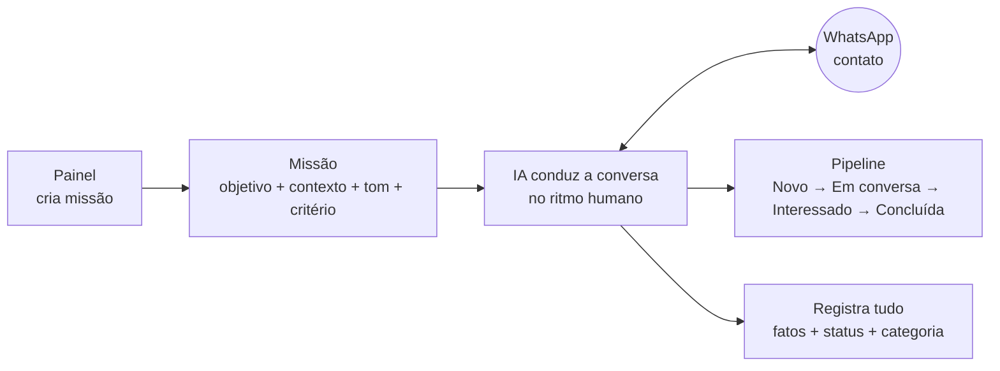
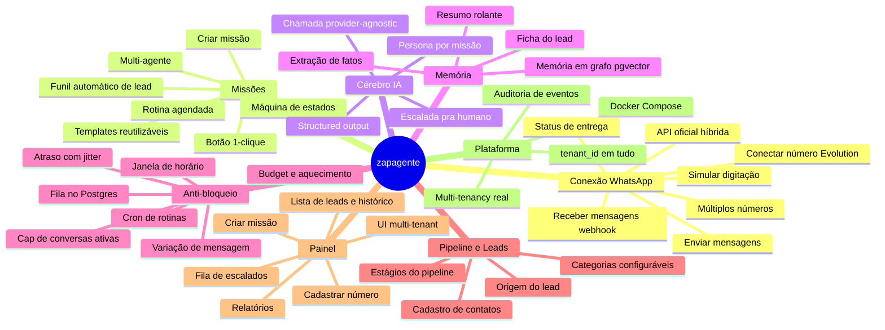
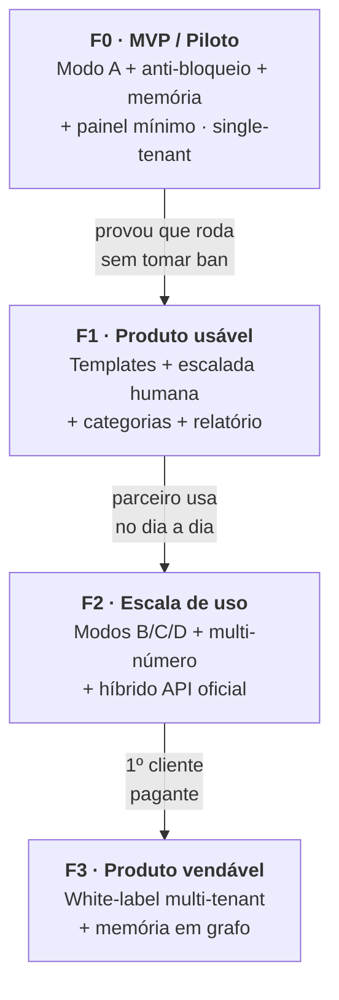

# zapagente — Roadmap & Divisão de Funcionalidades

> Consolida os estudos em [docs/estudos/](estudos/) numa visão única: **o que** o produto faz, **como** as funcionalidades se agrupam e em **que ordem** construir.
> Base: [ESTRUTURA](estudos/ESTRUTURA.md) · [DECISÕES](estudos/DECISOES-stack-arquitetura-roadmap.md) · [ARQUITETURA-TÉCNICA](estudos/ARQUITETURA-TECNICA.md) · [ESTUDO-memória-e-custo](estudos/ESTUDO-memoria-e-custo.md).

**Legenda de fase:** `F0` MVP/Piloto · `F1` Produto usável · `F2` Escala de uso · `F3` Produto vendável (white-label).

---

## 1. O produto em uma imagem

A unidade do sistema é **(número) + (missão)**. Você configura uma missão e "solta" a IA; ela conduz a conversa no ritmo humano e move o contato num pipeline até a missão ser cumprida.

---

## 2. As 4 formas de operar (modos)

| Modo | O que é | Fase |
|---|---|---|
| **A — Missão dirigida** | Eu escolho o contato e dou a missão; a IA toca a conversa. | ⭐ `F0` |
| **B — Funil automático** | Lead cai no sistema (indicação/lista) → qualificação automática. | `F2` |
| **C — Tarefa 1-clique** | Botão dispara missão pré-configurada (ex.: pedir água, cobrar relatório). | `F2` |
| **D — Rotina agendada** | Mensagens em dias/horários fixos (ex.: seg/qua/sex 09h). | `F2` |

---

## 3. Mapa de funcionalidades

Todo o produto, dividido em **8 grupos**. Cada folha é uma funcionalidade construível.

---

## 4. Funcionalidades por fase (matriz de construção)

Cada linha mapeia a funcionalidade → grupo → **bloco do backend** (ver [ARQUITETURA-TÉCNICA §1](estudos/ARQUITETURA-TECNICA.md)) → fase.

| Funcionalidade | Grupo | Bloco backend | Fase |
|---|---|---|---|
| Conectar número (sessão Evolution) | Conexão | Executor / Núcleo | `F0` |
| Receber mensagens (webhook) | Conexão | 1. Ingestor | `F0` |
| Enviar mensagens + status | Conexão | 6. Executor | `F0` |
| Simular digitação (presença) | Conexão | 6. Executor | `F0` |
| Criar missão (objetivo/contexto/tom/critério) | Missões | 7. API painel | `F0` |
| Máquina de estados da missão | Missões | 4. Máquina de estados | `F0` |
| Chamada LLM provider-agnostic | Cérebro IA | 3. Cérebro IA | `F0` |
| Structured output (estado/categoria/fatos) | Cérebro IA | 3. Cérebro IA | `F0` |
| Persona/prompt por missão | Cérebro IA | 3. Cérebro IA | `F0` |
| Ficha do lead (montador de contexto) | Memória | 2. Montador | `F0` |
| Extração de fatos | Memória | 2. Montador | `F0` |
| Fila no Postgres + worker | Anti-bloqueio | 5. Fila/agendador | `F0` |
| Budget por número + aquecimento | Anti-bloqueio | 5. Fila/agendador | `F0` |
| Janela de horário | Anti-bloqueio | 5. Fila/agendador | `F0` |
| Cap de conversas ativas | Anti-bloqueio | 5. Fila/agendador | `F0` |
| Atraso com jitter | Anti-bloqueio | 5. Fila/agendador | `F0` |
| Variação de mensagem | Anti-bloqueio | 3. Cérebro IA | `F0` |
| Contatos + estágios + categorias | Pipeline | 7. API painel | `F0` |
| Cadastrar número (UI) | Painel | Painel | `F0` |
| Criar missão (UI) | Painel | Painel | `F0` |
| Lista de leads + status + histórico | Painel | Painel | `F0` |
| Docker Compose (pg/evolution/api/painel) | Plataforma | Infra | `F0` |
| `tenant_id` em todas as tabelas | Plataforma | Infra | `F0` |
| Escalada pra humano (guardrail) | Cérebro IA | 3 + Painel | `F1` |
| Templates de missão reutilizáveis | Missões | 7. API painel | `F1` |
| Resumo rolante | Memória | 2. Montador | `F1` |
| Fila de escalados (humano assume) | Painel | Painel | `F1` |
| Relatórios | Painel | Painel | `F1` |
| Auditoria de eventos (timeline) | Plataforma | Infra | `F1` |
| Botão 1-clique (Modo C) | Missões | 4 + 7 | `F2` |
| Rotina agendada / cron (Modo D) | Missões | 5. Agendador | `F2` |
| Funil automático de lead (Modo B) | Missões | 4. Máquina de estados | `F2` |
| Múltiplos números | Conexão | 5 + 6 | `F2` |
| API oficial híbrida (inbound opt-in) | Conexão | 1 + 6 | `F2` |
| Multi-agente / múltiplas personas | Missões | 3. Cérebro IA | `F3` |
| Memória em grafo (pgvector) | Memória | 2. Montador | `F3` |
| Multi-tenancy real + UI white-label | Plataforma | Infra + Painel | `F3` |

---

## 5. Roadmap em fases

Regra de ouro: **cada fase só começa quando a anterior provou valor** (piloto → 1 cliente → 3 clientes → white-label).

---

## 6. Fase 0 (MVP) — o que construir primeiro

Escopo travado do piloto (Modo A + anti-bloqueio), em **fatias verticais** na ordem sugerida:

1. **Fundação** — repo, Docker Compose (postgres + evolution + api + painel), schema com `tenant_id`, config/env.
2. **Conexão** — conectar número na Evolution, webhook de entrada (Ingestor), envio de saída (Executor).
3. **Missão + estados** — criar missão pelo painel; máquina de estados (`configurada → na_fila → em_conversa → concluída/descartada/escalada/sem_resposta`).
4. **Cérebro IA** — chamada provider-agnostic + structured output (`resposta, novo_estado, categoria, fatos, precisa_humano`).
5. **Memória** — montador da ficha do lead (persona + objetivo + contexto + fatos + resumo + últimas ~8 msgs).
6. **Anti-bloqueio** — fila no Postgres, budget/aquecimento por número, janela de horário, cap de ativas, jitter, digitação simulada.
7. **Painel mínimo** — cadastrar número, criar missão, lista de leads com status/histórico.
8. **Piloto real** — rodar numa empresa do parceiro com número aquecido.

**Critério de "MVP pronto":** uma missão dirigida roda ponta a ponta num número aquecido, conduz a conversa no ritmo humano e move o lead pelo pipeline — **sem tomar bloqueio**.

---

## 7. Dependências externas (não dependem só do Pedro)

Antes/durante o F0, alinhar com o parceiro (ver [DECISÕES](estudos/DECISOES-stack-arquitetura-roadmap.md)):

- ⚖️ **Risco de ban aceito** — número dedicado + aquecimento (o chip pode cair).
- 🧑‍💼 **Specs da VPS** — confirmar RAM/CPU (alvo ~2 vCPU / 4 GB).
- 🧑‍💼 **n8n fora do core** — Node puro no crítico (recomendado).
- 💰 **Modelo mini da OpenAI** — escolher e estimar custo real do piloto.
- ⚖️ **Base morna, não fria** — a regra das 48h da Meta favorece começar com contatos que já responderam.

---

## 8. Backlog & próximas capacidades (pós-teste Costa Doce · 2026-07-22)

Itens levantados no teste ao vivo (ver [aprendizados-teste-costa-doce](aprendizados-teste-costa-doce.md)).

### 8.1 📚 Biblioteca de documentos do tenant — ingestão + RAG + envio pela IA `F2`
**O cliente sobe os próprios materiais** (docx/pdf/imagem): catálogos, **menus/cardápios**, tabelas, materiais de expedição (informativo, roteiro, logística), contratos. O sistema então:
- **(a) Vira fonte da verdade** — transforma o documento em **Conhecimento** consultável (curado e, na evolução, **RAG**: a IA busca o trecho relevante sozinha). Substitui o processo manual de hoje (alguém destila o doc e cola texto em `informacoes`/`Conhecimento`).
- **(b) A IA ENVIA o arquivo ao cliente** na hora certa (ex.: mandar o cardápio, o catálogo, o PDF da expedição) — como foi feito com o PDF da Costa Doce no teste.
- Escopo por tenant (a biblioteca é do cliente); pastas/categorias (ex.: reaproveitar a taxonomia do Mini Drive: Expedições/Artes/Institucional).

> **Já feito:** (1) a IA **enviar arquivo/mídia** ao contato (`enviarDocumento` / `sendMedia`); (2) **ingestão versão (a)** — subir PDF/DOCX/TXT no painel (aba Conhecimento → "Importar documento") → extrai o texto (`core/documentos/extrair-texto`, pdf-parse/mammoth) → vira uma entrada de **Conhecimento** do tenant; (3) ✅ **versão (b) RAG** — `core/embeddings/` (text-embedding-3-small, cosseno em memória) + `ConhecimentoChunk`: cada item aprovado é fatiado e vetorizado; o harness injeta **só os trechos relevantes** (fallback p/ tudo quando embeddings off). **Falta:** a **UI de biblioteca por pastas/categorias** + suporte a imagem (OCR).

### 8.2 💸 Otimização de custo do LLM `F1`
Custo hoje é baixíssimo (~R$0,06 numa conversa longa de 27 turnos), mas dá pra cortar:
- ✅ **Throttle do resumo (COST-2)** — `resumir` agora roda a cada 3 turnos (ou ao concluir), não todo turno. Corta ~1/3 das chamadas.
- ✅ **RAG em vez de contexto fixo (RAG-1)** — o conhecimento vai por **trechos relevantes** (não a base inteira) em cada `gerar`; escala a base sem inflar o prompt.

### 8.3 📊 Instrumentação de custo & escala `F1`
- ✅ **(COST-1)** — captura o `usage` (tokens in/out) de cada chamada OpenAI **por missão** (`Missao.tokensEntrada/tokensSaida`) e exibe no detalhe da missão (card "Custo de IA", **só super-admin**, escondido no servidor p/ não-super). **Falta (evolução):** agregado por tenant/dia num dashboard.
- **Baseline medido:** ~US$0,01 (~R$0,06) por conversa longa → **~R$60 / 1.000 conversas**. A IA é barata; o custo real é infra + chip + trabalho. Serve pra precificar a revenda com margem clara.

### 8.4 🚀 Deploy "always-on desassistido" (bloqueadores de produção) `F1`
> Levantado na revisão 360° (2026-07-23). "Deploy" não é só subir o código — é **sobreviver em produção sem babá**. Além dos P0 de segurança já conhecidos (segredo no webhook, helmet/rate-limit/CORS, segredos fortes, rodar `backfill-rag.mts` 1×), faltam:
- **Observabilidade/alerta** — alertar quando `statusConexao != conectado` (chip caiu), `classificarSaude = risco`, e um heartbeat do worker. Hoje uma queda é silenciosa até o parceiro perceber que parou. Falha #1 esperada em produção.
- **Backup do Postgres** — hoje **ZERO backup**. `pg_dump` em cron + cópia off-site. Um VPS único com dados multi-tenant (contatos, conversas, consentimento LGPD) sem backup = perda total numa falha de disco. Bloqueador antes de dado real de cliente.
- **Teto de gasto da OpenAI** — a key é do parceiro, **única e compartilhada**. Setar limite hard + alerta na conta antes de rodar always-on (loop/abuso gasta sem freio).
- **Proteger a Evolution API** (:8080) — sobe junto no compose; se exposta, é vetor direto pro WhatsApp. Só acessível na rede interna/localhost + key forte.

### 8.5 💼 Camada comercial (pré-revenda) `F2`
> Lacuna estratégica da revisão: o roadmap tratava "multi-tenant técnico" como sinônimo de "vendável". O **encanamento** existe (isolamento, super-admin, impersonação); a **camada comercial** não. Sem ela, revender é manual e arriscado:
- **Estado + billing do tenant** — `Tenant` só tem `id/nome/criadoEm`. Falta `ativo` (cortar quem não paga) + `plano` + integração de cobrança BR (Asaas/Pagar.me/Stripe).
- **Quotas por tenant (entitlements de plano)** — hoje os limites são por número (budget/cap/teto de estágio), não por tenant (nº de números, missões/mês, contatos, quais features). Base pra diferenciar planos e conter custo.
- **Custo + teto por tenant** — COST-1 é por-missão; falta agregado por tenant e **corte automático** ao estourar (protege a key única do parceiro).
- **Gestão de usuários por tenant + reset de senha** — hoje `criarTenant` cria 1 admin; o cliente não adiciona operadores nem reseta senha sem mexer no banco.
- **Branding white-label** (logo/cor/domínio por tenant) e **hard-delete LGPD** (direito ao apagamento de contato+mensagens; hoje só opt-out).

> ⚠️ **Riscos de produção** (revisão): dependência da API não-oficial + "Aguardando esta mensagem" (dessincronização Signal com status `ok`) → mitigação é a escada oficial, mas **sem gatilho definido**; **chip único sem pool de rotação** (ponto único de ban); key OpenAI única do parceiro; **capacidade** da VPS 2vCPU/4GB apertada com Postgres+Evolution+Redis+API (RAG por cosseno em memória cresce com a base → pgvector antes do que se imagina).

### 8.6 🏷️ Tags/segmentação de contatos (CRM) `F1`
> Pedido do Pedro (2026-07-23). Hoje a audiência de uma campanha/missão é montada contato-a-contato (picker `SeletorContatos` + colar lista + "selecionar todos"). Falta **rotular contatos com tags** e disparar por segmento.
- **Marcar contatos com tags** (ex.: `lead-quente`, `costa-doce`, `inadimplente`, `cliente-2025`) — 1 contato pode ter N tags; gerenciar na página **Contatos** (adicionar/remover tag, filtrar a lista por tag).
- **Criar missão/campanha mirando uma tag** → dispara pra **todos os números daquela tag** de uma vez (reusa `criarMissaoEmLote`). O `SeletorContatos` ganha um filtro/atalho "todos da tag X".
- Atribuir tag **em lote** (na importação CSV/WhatsApp e via seleção múltipla). Respeita opt-out.
- **Esboço técnico:** model `Tag` (tenant-scoped) + N:N `ContatoTag`; `GET /contatos?tag=`; a criação de campanha aceita `tagId` como fonte de contatos. Casa com Contatos-CRM + Campanhas já existentes.

---

> **Nota (2026-07-23):** as seções §1–§7 (mapa/matriz/fases F0–F3) são o **plano pré-construção** e ficaram **desatualizadas** — na prática F1/F2 estão quase inteiros e parte do F3 (multi-tenant) foi feita. O **status real por fatia está no [CLAUDE.md](../CLAUDE.md)**; o backlog vivo é esta §8. Ao ler as fases abaixo, tratar como histórico de intenção, não como estado atual.
