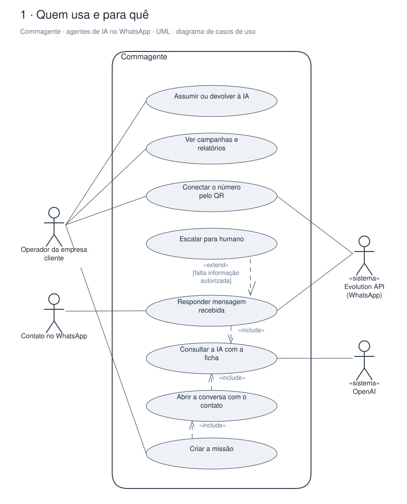
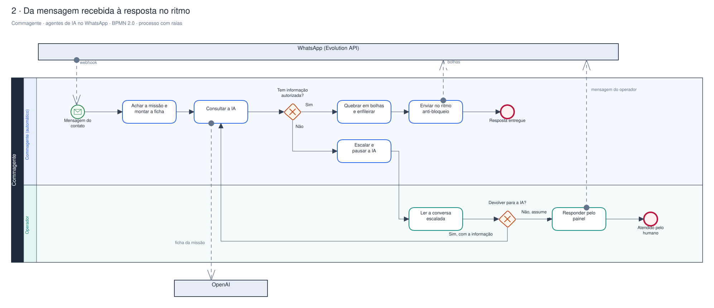
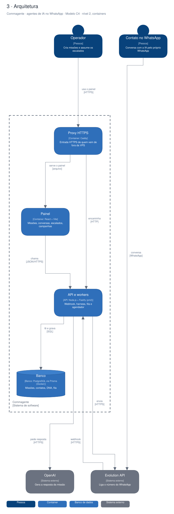

# Arquitetura

Diagramas gerados a partir do Sinapse (o segundo cérebro do Pedro). Cada projeto tem três vistas,
cada uma numa notação padrão:

1. **Quem usa e para quê**: UML, diagrama de casos de uso.
2. **O processo principal**: BPMN 2.0, com raias por quem executa.
3. **A arquitetura**: modelo C4, nível 2 (containers).

## Commagente · agentes de IA no WhatsApp

Plataforma multi-tenant white-label do Pedro com o parceiro: cada conversa no WhatsApp é uma missão (vender, qualificar, orçar, cobrar, suporte), a IA conduz no ritmo anti-bloqueio e escala para um humano quando precisa.

### Quem usa e para quê (UML)

### Da mensagem recebida à resposta no ritmo (BPMN 2.0)

### Arquitetura (C4, containers)

Editável: [`assistente-ia-whatsapp.excalidraw`](./assistente-ia-whatsapp.excalidraw), abre em [excalidraw.com](https://excalidraw.com) ou no VS Code com a extensão Excalidraw.

A fonte destes arquivos é o vault do Sinapse (`09-DESENHOS/`); alterações feitas aqui são sobrescritas na próxima publicação.
