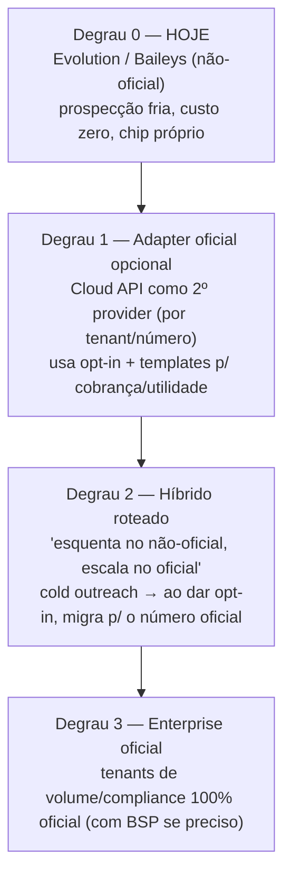

# Escada para a API oficial do WhatsApp

> Como o Commagente sai da API **não-oficial** (Evolution/Baileys) rumo à **oficial**
> (WhatsApp Cloud API, da Meta) — em degraus, sem reescrever o produto.
> Contexto de mercado e por que isso importa: ver **[pesquisa-mercado.html](pesquisa-mercado.html)**.

## O dilema em uma frase

| | Não-oficial (Evolution/Baileys) — **hoje** | Oficial (Cloud API / Meta) |
|---|---|---|
| Iniciar conversa fria (lead novo) | ✅ livre | ⚠️ só com **template aprovado** (HSM) |
| Texto livre | ✅ sempre | ✅ **só dentro da janela de 24h** após a última msg do cliente |
| Custo por mensagem | ~zero | **pago** por conversa/mensagem, por categoria |
| Risco de bloqueio | 🔴 alto (é o gatilho de ban: msgs não-respondidas) | 🟢 ~nulo (é sancionado pela Meta) |
| Opt-in do contato | recomendado | **obrigatório** |
| Setup | escanear QR | conta Meta Business + número verificado + templates aprovados |

**A leitura estratégica:** o não-oficial é imbatível pra **prospecção fria barata** (nosso
diferencial de "missões" proativas), mas carrega risco de ban. O oficial é **seguro e
compliant**, porém **não deixa você abordar número frio livremente** — precisa de opt-in +
template. Por isso a resposta não é "trocar", é **subir uma escada** e, no meio dela, **rodar
os dois juntos** (híbrido).

## A escada

- **Degrau 0 (hoje):** tudo pelo Evolution. Ótimo pra validar, vender e prospectar barato.
- **Degrau 1:** entra um **adapter oficial** implementando a MESMA `PortaWhatsApp`. Escolhível
  por env (global) e, idealmente, **por número** (campo em `NumeroWhatsapp`). Usa-se o oficial
  onde ele brilha: **cobrança, lembretes, utilitárias e suporte a quem já deu opt-in** (templates
  aprovados + janela de 24h).
- **Degrau 2 (híbrido, o "pulo do gato"):** cold outreach continua no não-oficial (chip
  descartável); **quando o lead responde / dá opt-in**, a conversa "sobe" para o número oficial —
  compliant e sem risco de ban dali pra frente. Junta o melhor dos dois.
- **Degrau 3:** clientes grandes / regulados rodam 100% oficial, eventualmente via um BSP
  (Business Solution Provider) se precisarem de volume ou verificação.

## O que muda no domínio (conceitos novos do oficial)

1. **Janela de 24h:** fora dela, só **template** pré-aprovado. Dentro, texto livre.
   → nosso harness precisa saber "estou dentro/fora da janela?" e, se fora, mandar um template.
2. **Templates (HSM):** mensagens modelo aprovadas pela Meta, por categoria
   (marketing / utility / authentication / service). → novo model `TemplateWhatsapp` (degrau 1+).
3. **Opt-in obrigatório:** **já temos** — `Contato.optIn*` e opt-out (Tier 0). É pré-requisito
   que o produto já cumpre. 👍
4. **"Iniciar conversa livre" não existe no oficial:** o opener proativo vira **template**.
   → o `processarTurno`, quando o número for oficial e estiver fora da janela, escolhe um template
   em vez de gerar texto solto.
5. **Custo por conversa:** instrumentar gasto por missão/tenant (a Meta cobra por categoria;
   conferir a **tabela atual** — muda com frequência). Service (iniciada pelo cliente) costuma ser
   mais barata/gratuita dentro da janela; marketing é a mais cara.

## O caminho no código (a arquitetura já está pronta)

O seam já existe: features falam com a **porta** `PortaWhatsApp`
([core/evolution/porta-whatsapp.ts](../apps/api/src/core/evolution/porta-whatsapp.ts)), nunca com
a Evolution direto. A seleção do provider é centralizada em
[core/evolution/index.ts](../apps/api/src/core/evolution/index.ts) (`WHATSAPP_PROVIDER`, igual ao
`IA_PROVIDER`/`TRANSCRITOR_PROVIDER`). Então o degrau 1 é, mecanicamente:

1. **`core/evolution/cloud-api.client.ts`** — novo adapter que implementa `PortaWhatsApp` sobre a
   Graph API da Meta:
   - `enviarTexto` → `POST /{phone-id}/messages` (type `text`) **se dentro da janela**;
   - **novo** `enviarTemplate(...)` → type `template` (fora da janela / opener proativo);
   - `configurarWebhook` → cadastro do webhook na Meta + **verify token** (challenge GET);
   - `statusConexao`/`criarInstancia`/`conectar` → adaptados (não há QR: é registro de número +
     token); `baixarMidiaBase64` → endpoint de mídia autenticado; `buscarContatos` → **indisponível**
     (contatos vêm de opt-in, não de agenda).
2. **Normalizar o webhook da Meta** em `webhook.dominio.ts` (payload diferente do Evolution:
   `entry[].changes[].value.messages[]`, status em `statuses[]`). O resto do fluxo (ingestor,
   harness, fila) **não muda**.
3. **Provider por número:** `NumeroWhatsapp.provider` (`evolution` | `cloud`) + a fila/executor
   escolhem o adapter certo por número → habilita o **degrau 2 (híbrido)**.
4. **Templates:** model `TemplateWhatsapp` + tela no painel + escolha do template no opener quando
   fora da janela.

**Resumo:** a "escada" não pede reescrita — pede **um adapter novo atrás da porta que já existe**,
um normalizador de webhook, e (pra híbrido) provider por número. O domínio, o harness, a fila
anti-bloqueio, a memória e o painel seguem iguais.

## Quando subir cada degrau

- **Fique no 0** enquanto o foco é validar/vender e prospecção fria barata (PMEs). É o nosso trunfo.
- **Suba pro 1** quando um tenant precisar de **cobrança/utilitárias confiáveis** ou reclamar de
  ban — dá o canal seguro sem perder o frio.
- **Suba pro 2** quando o volume de leads "quentes" justificar proteger o relacionamento (o híbrido
  é o posicionamento mais forte do produto).
- **Degrau 3** só sob demanda de cliente enterprise/regulado.

> ⚠️ Números e regras da Meta (preços por categoria, limites de envio, revisão de templates) mudam
> com frequência — confirmar sempre na documentação oficial vigente antes de precificar/prometer.

## Degrau 1 — CONSTRUÍDO no código (2026-07-28)

Adapter pronto atrás da porta (default segue Evolution; ativa com `WHATSAPP_PROVIDER=cloud`):
- `core/evolution/cloud-api.client.ts` — envia texto/documento (upload de mídia), baixa mídia; `statusConexao`/`conectar`/`criarInstancia`/`configurarWebhook` adaptados (oficial NÃO tem QR).
- `core/evolution/index.ts` — provider `cloud` registrado no seam.
- `features/webhook/webhook.dominio.ts` — `normalizarMeta` decodifica o payload da Meta (`entry[].changes[].value.{messages|statuses}`) pro MESMO `EventoWa` → ingestor/harness/fila NÃO mudam.
- `features/webhook/webhook.rotas.ts` — GET de verificação (`hub.challenge` vs `CLOUD_API_VERIFY_TOKEN`).
- `core/config.ts` + `.env.example` — `CLOUD_API_TOKEN`/`CLOUD_API_PHONE_ID`/`CLOUD_API_VERIFY_TOKEN`/`CLOUD_API_GRAPH_VERSION`.

⚠️ **Ainda NÃO testado contra a Meta real** (faltam credenciais). Degrau 1 cobre **RESPOSTA dentro da janela de 24h** — que é exatamente o "responder o cliente engajado" que estava com *aguardando*. **Opener fora da janela = template aprovado** (`enviarTemplate` + model `TemplateWhatsapp`) → degrau 1+ (TODO).

## Onboarding na Meta (externo — Pedro/parceiro; ~1–3 dias de revisão)
1. **Meta Business** (business.facebook.com) + verificação do negócio (CNPJ) se pedir.
2. **App** em developers.facebook.com → adicionar produto **WhatsApp** → *API Setup*.
3. **Número:** registrar um número NA Cloud API. ⚠️ um número em Baileys **NÃO** pode estar nos dois ao mesmo tempo — usar um número **dedicado** ao oficial. Anotar o **phone_number_id**.
4. **Token PERMANENTE:** criar um **System User** no Business + token permanente com `whatsapp_business_messaging` (o token de *API Setup* expira em 24h — não serve pra prod).
5. **Webhook:** WhatsApp > Configuration → Callback URL = `https://<dominio>/api/webhook/<segredo>` + Verify Token = o `CLOUD_API_VERIFY_TOKEN`; assinar o campo **messages**. **Exige HTTPS** (ver pendência de HTTPS).
6. **`.env`** do número oficial: `WHATSAPP_PROVIDER=cloud` + os `CLOUD_API_*`. Convenção do normalizador: `NumeroWhatsapp.instanciaEvolution` desse número = o **phone_number_id**.
7. **Templates** (opener/cobrança fora da janela): criar + aprovar no Business Manager (degrau 1+).

## ATUALIZAÇÃO 2026-07-31 — reframe da estratégia (pós-pesquisa de mercado)

Uma pesquisa de mercado (jul/2026) mudou dois pontos da abordagem:

- **✅ HTTPS resolvido.** A VPS já tem Caddy com TLS automático: `https://<ip-do-servidor>.sslip.io` (cert Let's Encrypt válido; o HTTP do IP cru segue funcionando). O webhook da Meta pode apontar pra `https://<ip-do-servidor>.sslip.io/api/webhook/<segredo>` **hoje** — o gargalo de HTTPS **saiu**. (Trocar pelo domínio real depois = 1 linha no Caddyfile.)
- **🔑 A própria Evolution já fala a Cloud API oficial** pelos MESMOS endpoints REST (modo multi-provider `baileys`/`cloudapi`). Então há **DOIS caminhos** pro oficial:
  - **(A) Nosso adapter próprio** (`cloud-api.client.ts`, já construído) — controle total, fala direto o Graph API da Meta.
  - **(B) Modo `cloudapi` da Evolution** — trocar o provider da instância; nosso código quase não muda. **Menos esforço pra pilotar.**
  - **Recomendação:** pilotar com **(B)** (rápido, reusa o que já roda) e manter **(A)** como opção de controle fino. Reavaliar depois de 1 tenant no ar.
- **Estratégia de fases (da pesquisa):** mover primeiro a camada **REATIVA (suporte)** pro oficial — dentro da janela de 24h é **grátis** e **zero risco de ban**; é onde o oficial ganha limpo e onde o "aguardando" mais dói. Outreach proativo vira **templates de utility** (barato/conforme); não-oficial fica como **fallback tático**. Motivo extra: as regressões de 2026 (passkey "Shortcake", erro 428) deixaram o **pareamento de número NOVO instável em TODAS as libs não-oficiais** — arriscado pra onboarding de tenant.

**Bloqueio remanescente = SÓ credenciais Meta** (Business + número dedicado + token permanente do System User) — ação do parceiro. Todo o resto (HTTPS, adapter, normalizador, config, webhook verify) já está pronto.
